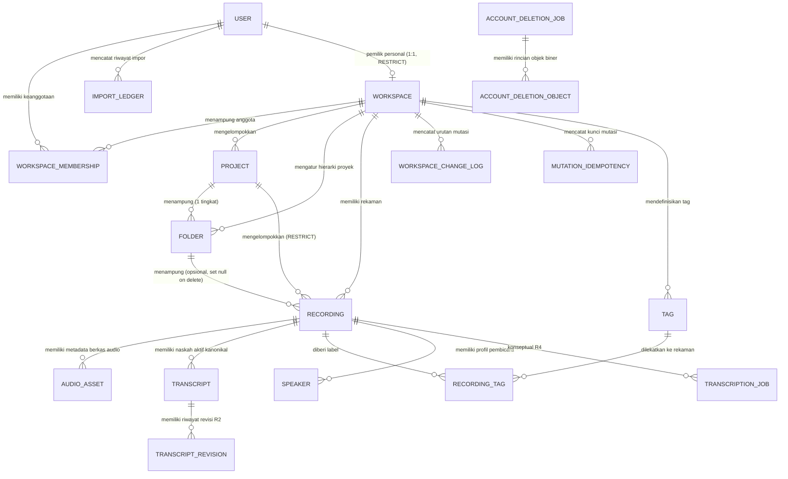

# Desain Cloud Data Model (Fase R2)

Dokumen ini mendefinisikan desain arsitektur data model cloud untuk platform transkripsi Catetin (rename-ready). Dokumen ini mencakup struktur entitas Cloudflare D1, pemisahan muatan biner dengan Cloudflare R2, kontrak sinkronisasi delta berbasis monotonic sequence untuk seluruh syncable child entities, penanganan idempotensi mutasi, alur penghapusan akun berdaya tahan tinggi (*durable account deletion* dengan outbox terdistribusi), integritas referensial multi-tenant berbasis composite foreign keys, kontrol konkurensi optimistik, serta batasan privasi dan otorisasi multi-tenant.

---

## 1. Tujuan & Non-Goals

### Tujuan Utama
1. **Pondasi Metadata Lintas Perangkat:** Mendukung multi-device sync antara Web Studio, Android, dan iOS menggunakan identitas akun terpadu.
2. **Pemisahan Workspace & Multi-Tenancy Aman:** Mendukung personal workspace (1:1, terikat ke pengguna melalui `personal_owner_user_id` dengan `ON DELETE RESTRICT`) dan shared workspace tim (ownership ditentukan melalui peran `owner` pada `workspace_membership`).
3. **Integritas Referensial Multi-Tenant:** Database D1 secara tegas menolak relasi cross-workspace menggunakan composite foreign keys pada seluruh entitas anak dan junction.
4. **Folder Flat per Proyek:** Setiap folder wajib bernaung di bawah satu project tertentu (`project_id`), tidak mendukung folder bersarang (*no nested folders*), dan relasi rekaman-ke-folder diverifikasi agar selalu berada dalam project dan workspace yang sama.
5. **Penyimpanan Dokumen Transkrip Kanonikal:** Menyimpan naskah transkrip aktif (*current editable document*) langsung di Cloudflare D1 sebagai dokumen JSON terstruktur dengan batasan keamanan produk maksimal 1 MB per naskah (dihitung berdasarkan panjang byte UTF-8).
6. **Multiplisitas Revisi Transkrip:** Mendukung banyak revisi per naskah (`revision_number`) dengan composite foreign key tunggal ke naskah aktif tanpa batasan prematur.
7. **Pemisahan Metadata & Payload Biner:** Berkas biner audio dan checkpoint/revisi transkrip historis yang tidak aktif dialokasikan ke Cloudflare R2 dengan pointer metadata di D1 tanpa mengekspos kunci internal R2 pada DTO publik klien.
8. **Sinkronisasi Tambahan (Incremental Sync) Berbasis Monotonic Sequence:** Klien dapat bekerja offline dan melakukan sinkronisasi delta menggunakan urutan perubahan yang dikeluarkan server (*server-issued monotonic change sequence*), mencakup seluruh syncable entities (project, folder, recording, transcript, tag, audio_asset, speaker, recording_tag).
9. **Penanganan Idempotensi Tangguh:** Mencegah mutasi ganda akibat gangguan koneksi jaringan menggunakan pelacakan kunci mutasi berskala `UNIQUE(workspace_id, user_id, client_mutation_id)` dan verifikasi hash muatan dengan masa retensi 7 hari.
10. **Normalisasi Tag Handal:** Mencegah duplikasi tag akibat perbedaan huruf besar/kecil atau spasi luar menggunakan kolom `normalized_name` dan constraint `UNIQUE(workspace_id, normalized_name)`.
11. **Siklus Hidup Penghapusan Akun yang Durable & Bertahan:** Menjamin pembersihan berkas R2 sebelum pembersihan baris identitas D1, menggunakan tabel pekerjaan mandiri yang tidak bergantung pada cascade baris `user` (*no cascade on job*), dengan manifest objek terperinci per baris pada `account_deletion_object`.
12. **Rename-Ready & Netral:** Seluruh tabel, kolom, indeks, tipe data, dan kontrak API tidak menggunakan string nama brand tertentu.

### Non-Goals (Bukan Bagian dari Fase R2)
- Tidak mengimplementasikan alur upload audio biner atau endpoint upload bertingkat (presigned URL / TUS).
- Tidak mengeksekusi operasi penghapusan objek R2 riil atau pengunggahan revisi R2 riil (dijalankan pada fase storage setelah binding R2 tersedia).
- Tidak membuat Cloudflare Queue atau mengubah alur produksi `DELETE /api/account` yang sedang aktif.
- Tidak menyertakan tabel pemrosesan transkripsi (`transcription_job`) ke dalam migrasi 0004 (ditunda ke fase R4).
- Tidak mengintegrasikan API pihak ketiga (Deepgram Nova-3, speech engine, atau AI assist).
- Tidak menambahkan tabel billing, transaksi saldo, atau referral ke skema database D1 saat ini.
- Tidak memodifikasi kode produksi frontend atau skema lokal IndexedDB yang sedang aktif.
- Tidak mengeksekusi migrasi D1 ke lingkungan remote staging atau produksi.

---

## 2. Diagram Hubungan Entitas (Entity-Relationship Diagram)



---

## 3. Spesifikasi Skema Database D1 (Migration 0004)

Seluruh identifier waktu menggunakan Unix timestamp milidetik (`INTEGER`) UTC yang dihasilkan secara otoritatif oleh server Cloudflare Workers. Kunci primer menggunakan ID bertipe string dengan awalan semantik (misalnya `ws_`, `prj_`, `fld_`, `rec_`, `aud_`, `txn_`, `rev_`, `spk_`, `tag_`, `rt_`, `chg_`, `idem_`, `imp_`, `del_`, `delobj_`).

### 3.1. Entitas Workspace & Otorisasi

```sql
-- 1. Workspace (Multi-tenant container)
CREATE TABLE workspace (
    id TEXT PRIMARY KEY,
    type TEXT NOT NULL CHECK(type IN ('personal', 'team')),
    name TEXT NOT NULL,
    slug TEXT NOT NULL UNIQUE,
    personal_owner_user_id TEXT UNIQUE,
    latest_change_seq INTEGER NOT NULL DEFAULT 0,
    min_valid_sync_seq INTEGER NOT NULL DEFAULT 0,
    created_at INTEGER NOT NULL,
    updated_at INTEGER NOT NULL,
    deleted_at INTEGER,
    CHECK ((type = 'personal' AND personal_owner_user_id IS NOT NULL) OR (type = 'team' AND personal_owner_user_id IS NULL)),
    CHECK (min_valid_sync_seq >= 0 AND latest_change_seq >= min_valid_sync_seq),
    FOREIGN KEY (personal_owner_user_id) REFERENCES "user"("id") ON DELETE RESTRICT
);
CREATE INDEX idx_workspace_deleted_at ON workspace(deleted_at);

-- 2. Workspace Membership (Role-Based Access Control)
CREATE TABLE workspace_membership (
    id TEXT PRIMARY KEY,
    workspace_id TEXT NOT NULL,
    user_id TEXT NOT NULL,
    role TEXT NOT NULL CHECK(role IN ('owner', 'admin', 'member')),
    created_at INTEGER NOT NULL,
    updated_at INTEGER NOT NULL,
    FOREIGN KEY (workspace_id) REFERENCES workspace(id) ON DELETE CASCADE,
    FOREIGN KEY (user_id) REFERENCES "user"("id") ON DELETE CASCADE,
    UNIQUE (workspace_id, user_id)
);
CREATE INDEX idx_membership_user ON workspace_membership(user_id);
```

### 3.2. Struktur Organisasi Konten (Project, Folder, Tag)

```sql
-- 3. Project
CREATE TABLE project (
    id TEXT PRIMARY KEY,
    workspace_id TEXT NOT NULL,
    name TEXT NOT NULL,
    description TEXT,
    created_by_user_id TEXT NOT NULL,
    version INTEGER NOT NULL DEFAULT 1,
    created_at INTEGER NOT NULL,
    updated_at INTEGER NOT NULL,
    deleted_at INTEGER,
    UNIQUE (workspace_id, id),
    FOREIGN KEY (workspace_id) REFERENCES workspace(id) ON DELETE CASCADE,
    FOREIGN KEY (created_by_user_id) REFERENCES "user"("id") ON DELETE RESTRICT
);
CREATE INDEX idx_project_workspace_updated ON project(workspace_id, updated_at DESC);

-- 4. Folder (Flat single-level hierarchy per project, no nested folders)
CREATE TABLE folder (
    id TEXT PRIMARY KEY,
    workspace_id TEXT NOT NULL,
    project_id TEXT NOT NULL,
    name TEXT NOT NULL,
    color TEXT,
    version INTEGER NOT NULL DEFAULT 1,
    created_at INTEGER NOT NULL,
    updated_at INTEGER NOT NULL,
    deleted_at INTEGER,
    UNIQUE (workspace_id, project_id, id),
    UNIQUE (workspace_id, id),
    FOREIGN KEY (workspace_id, project_id) REFERENCES project(workspace_id, id) ON DELETE CASCADE
);
CREATE INDEX idx_folder_workspace_updated ON folder(workspace_id, updated_at DESC);

-- 5. Tag
CREATE TABLE tag (
    id TEXT PRIMARY KEY,
    workspace_id TEXT NOT NULL,
    name TEXT NOT NULL,
    normalized_name TEXT NOT NULL,
    version INTEGER NOT NULL DEFAULT 1,
    created_at INTEGER NOT NULL,
    updated_at INTEGER NOT NULL,
    deleted_at INTEGER,
    UNIQUE (workspace_id, id),
    UNIQUE (workspace_id, normalized_name),
    FOREIGN KEY (workspace_id) REFERENCES workspace(id) ON DELETE CASCADE
);
```

### 3.3. Entitas Rekaman & Aset Audio

```sql
-- 6. Recording (Metadata induk rekaman)
CREATE TABLE recording (
    id TEXT PRIMARY KEY,
    workspace_id TEXT NOT NULL,
    project_id TEXT,
    folder_id TEXT,
    title TEXT NOT NULL,
    category TEXT NOT NULL DEFAULT 'general',
    duration_sec REAL NOT NULL DEFAULT 0.0,
    created_by_user_id TEXT NOT NULL,
    version INTEGER NOT NULL DEFAULT 1,
    created_at INTEGER NOT NULL,
    updated_at INTEGER NOT NULL,
    deleted_at INTEGER,
    CHECK (folder_id IS NULL OR project_id IS NOT NULL),
    UNIQUE (workspace_id, id),
    FOREIGN KEY (workspace_id) REFERENCES workspace(id) ON DELETE CASCADE,
    FOREIGN KEY (workspace_id, project_id) REFERENCES project(workspace_id, id) ON DELETE RESTRICT,
    FOREIGN KEY (folder_id) REFERENCES folder(id) ON DELETE SET NULL,
    FOREIGN KEY (created_by_user_id) REFERENCES "user"("id") ON DELETE RESTRICT
);
CREATE INDEX idx_recording_workspace_updated ON recording(workspace_id, updated_at DESC);
CREATE INDEX idx_recording_workspace_project ON recording(workspace_id, project_id);
CREATE INDEX idx_recording_workspace_folder ON recording(workspace_id, folder_id);

-- Trigger untuk memvalidasi scope workspace dan project pada folder rekaman
CREATE TRIGGER trg_recording_folder_check_ins
BEFORE INSERT ON recording
WHEN NEW.folder_id IS NOT NULL
BEGIN
  SELECT RAISE(ABORT, 'FOREIGN KEY constraint failed: folder does not belong to same workspace and project')
  WHERE NOT EXISTS (
    SELECT 1 FROM folder f
    WHERE f.id = NEW.folder_id
      AND f.workspace_id = NEW.workspace_id
      AND (NEW.project_id IS NOT NULL AND f.project_id = NEW.project_id)
  );
END;

CREATE TRIGGER trg_recording_folder_check_upd
BEFORE UPDATE OF folder_id, project_id, workspace_id ON recording
WHEN NEW.folder_id IS NOT NULL
BEGIN
  SELECT RAISE(ABORT, 'FOREIGN KEY constraint failed: folder does not belong to same workspace and project')
  WHERE NOT EXISTS (
    SELECT 1 FROM folder f
    WHERE f.id = NEW.folder_id
      AND f.workspace_id = NEW.workspace_id
      AND (NEW.project_id IS NOT NULL AND f.project_id = NEW.project_id)
  );
END;

-- 7. Audio Asset (Metadata biner di Cloudflare R2 dengan siklus retensi mandiri)
CREATE TABLE audio_asset (
    id TEXT PRIMARY KEY,
    recording_id TEXT NOT NULL,
    workspace_id TEXT NOT NULL,
    r2_key TEXT NOT NULL,
    filename TEXT NOT NULL,
    mime_type TEXT NOT NULL,
    size_bytes INTEGER NOT NULL,
    duration_sec REAL NOT NULL,
    sha256 TEXT NOT NULL,
    retention_tier TEXT NOT NULL DEFAULT '30_days' CHECK(retention_tier IN ('7_days', '30_days', 'until_deleted')),
    purge_at INTEGER,
    version INTEGER NOT NULL DEFAULT 1,
    created_at INTEGER NOT NULL,
    updated_at INTEGER NOT NULL,
    deleted_at INTEGER,
    CHECK (
      (retention_tier = 'until_deleted' AND purge_at IS NULL)
      OR
      (retention_tier IN ('7_days', '30_days') AND purge_at IS NOT NULL)
    ),
    UNIQUE (workspace_id, id),
    FOREIGN KEY (workspace_id, recording_id) REFERENCES recording(workspace_id, id) ON DELETE CASCADE
);
CREATE INDEX idx_audio_purge ON audio_asset(purge_at);

-- 8. Recording Tag (Syncable many-to-many relationship)
CREATE TABLE recording_tag (
    id TEXT PRIMARY KEY,
    workspace_id TEXT NOT NULL,
    recording_id TEXT NOT NULL,
    tag_id TEXT NOT NULL,
    version INTEGER NOT NULL DEFAULT 1,
    created_at INTEGER NOT NULL,
    updated_at INTEGER NOT NULL,
    deleted_at INTEGER,
    UNIQUE (recording_id, tag_id),
    FOREIGN KEY (workspace_id, recording_id) REFERENCES recording(workspace_id, id) ON DELETE CASCADE,
    FOREIGN KEY (workspace_id, tag_id) REFERENCES tag(workspace_id, id) ON DELETE CASCADE
);
CREATE INDEX idx_rec_tag_tag ON recording_tag(tag_id);
```

### 3.4. Entitas Transkrip & Riwayat Revisi

```sql
-- 9. Speaker (Katalog pembicara per rekaman)
CREATE TABLE speaker (
    id TEXT PRIMARY KEY,
    recording_id TEXT NOT NULL,
    workspace_id TEXT NOT NULL,
    label TEXT NOT NULL,
    display_name TEXT NOT NULL,
    color TEXT,
    version INTEGER NOT NULL DEFAULT 1,
    created_at INTEGER NOT NULL,
    updated_at INTEGER NOT NULL,
    deleted_at INTEGER,
    UNIQUE (workspace_id, id),
    UNIQUE (recording_id, label),
    FOREIGN KEY (workspace_id, recording_id) REFERENCES recording(workspace_id, id) ON DELETE CASCADE
);
CREATE INDEX idx_speaker_recording ON speaker(recording_id);

-- 10. Transcript (Dokumen kanonikal aktif di D1)
CREATE TABLE transcript (
    id TEXT PRIMARY KEY,
    recording_id TEXT NOT NULL UNIQUE,
    workspace_id TEXT NOT NULL,
    summary_text TEXT,
    segment_count INTEGER NOT NULL DEFAULT 0,
    word_count INTEGER NOT NULL DEFAULT 0,
    raw_document_json TEXT NOT NULL,
    checksum TEXT NOT NULL,
    version INTEGER NOT NULL DEFAULT 1,
    created_at INTEGER NOT NULL,
    updated_at INTEGER NOT NULL,
    deleted_at INTEGER,
    UNIQUE (workspace_id, id),
    UNIQUE (workspace_id, recording_id),
    UNIQUE (workspace_id, id, recording_id),
    FOREIGN KEY (workspace_id, recording_id) REFERENCES recording(workspace_id, id) ON DELETE CASCADE
);
CREATE INDEX idx_transcript_workspace ON transcript(workspace_id);

-- 11. Transcript Revision (Metadata checkpoint / riwayat versi untuk R2)
CREATE TABLE transcript_revision (
    id TEXT PRIMARY KEY,
    transcript_id TEXT NOT NULL,
    recording_id TEXT NOT NULL,
    workspace_id TEXT NOT NULL,
    revision_number INTEGER NOT NULL,
    r2_key TEXT NOT NULL,
    size_bytes INTEGER NOT NULL,
    checksum TEXT NOT NULL,
    change_summary TEXT,
    created_by_user_id TEXT NOT NULL,
    created_at INTEGER NOT NULL,
    UNIQUE (transcript_id, revision_number),
    FOREIGN KEY (workspace_id, transcript_id, recording_id) REFERENCES transcript(workspace_id, id, recording_id) ON DELETE CASCADE,
    FOREIGN KEY (created_by_user_id) REFERENCES "user"("id") ON DELETE RESTRICT
);
CREATE INDEX idx_revision_transcript ON transcript_revision(transcript_id, revision_number DESC);
```

### 3.5. Entitas Sinkronisasi, Idempotensi, & Pelacakan Impor

```sql
-- 12. Workspace Change Log (Log urutan mutasi monotonik per workspace)
CREATE TABLE workspace_change_log (
    change_seq INTEGER PRIMARY KEY AUTOINCREMENT,
    workspace_id TEXT NOT NULL,
    entity_type TEXT NOT NULL CHECK(entity_type IN ('project', 'folder', 'recording', 'transcript', 'tag', 'audio_asset', 'speaker', 'recording_tag')),
    entity_id TEXT NOT NULL,
    operation TEXT NOT NULL CHECK(operation IN ('upsert', 'delete')),
    version INTEGER NOT NULL,
    changed_at INTEGER NOT NULL,
    FOREIGN KEY (workspace_id) REFERENCES workspace(id) ON DELETE CASCADE
);
CREATE INDEX idx_change_log_lookup ON workspace_change_log(workspace_id, change_seq ASC);

-- 13. Mutation Idempotency (Pencegah duplikasi mutasi, retensi 7 hari)
CREATE TABLE mutation_idempotency (
    id TEXT PRIMARY KEY,
    workspace_id TEXT NOT NULL,
    user_id TEXT NOT NULL,
    client_mutation_id TEXT NOT NULL,
    payload_hash TEXT NOT NULL,
    response_payload TEXT NOT NULL,
    created_at INTEGER NOT NULL,
    expires_at INTEGER NOT NULL,
    FOREIGN KEY (workspace_id) REFERENCES workspace(id) ON DELETE CASCADE,
    FOREIGN KEY (user_id) REFERENCES "user"("id") ON DELETE CASCADE,
    UNIQUE (workspace_id, user_id, client_mutation_id)
);
CREATE INDEX idx_idempotency_expires ON mutation_idempotency(expires_at);

-- 14. Import Ledger (Pelacak deduplikasi impor draf lokal, scoped per device & entity type)
CREATE TABLE import_ledger (
    id TEXT PRIMARY KEY,
    user_id TEXT NOT NULL,
    device_id TEXT NOT NULL,
    import_batch_id TEXT NOT NULL,
    entity_type TEXT NOT NULL CHECK(entity_type IN ('project', 'folder', 'recording')),
    local_source_id TEXT NOT NULL,
    cloud_entity_id TEXT NOT NULL,
    created_at INTEGER NOT NULL,
    FOREIGN KEY (user_id) REFERENCES "user"("id") ON DELETE CASCADE,
    UNIQUE (user_id, device_id, entity_type, local_source_id)
);
```

### 3.6. Entitas Alur Penghapusan Akun yang Durable & Mandiri

```sql
-- 15. Account Deletion Job (Induk pekerjaan penghapusan akun yang dapat bertahan hidup tanpa user)
CREATE TABLE account_deletion_job (
    id TEXT PRIMARY KEY,
    subject_user_id TEXT,
    status TEXT NOT NULL CHECK(status IN ('pending', 'deleting_objects', 'purging_d1', 'completed', 'failed')),
    attempt_count INTEGER NOT NULL DEFAULT 0,
    last_error TEXT,
    created_at INTEGER NOT NULL,
    updated_at INTEGER NOT NULL,
    completed_at INTEGER
);
CREATE INDEX idx_deletion_job_status ON account_deletion_job(status);

-- 16. Account Deletion Object (Rincian per objek R2 yang wajib dibersihkan)
CREATE TABLE account_deletion_object (
    id TEXT PRIMARY KEY,
    deletion_job_id TEXT NOT NULL,
    object_kind TEXT NOT NULL CHECK(object_kind IN ('audio_raw', 'transcript_revision')),
    object_key TEXT NOT NULL,
    status TEXT NOT NULL DEFAULT 'pending' CHECK(status IN ('pending', 'deleted', 'failed')),
    attempt_count INTEGER NOT NULL DEFAULT 0,
    last_error TEXT,
    deleted_at INTEGER,
    created_at INTEGER NOT NULL,
    FOREIGN KEY (deletion_job_id) REFERENCES account_deletion_job(id) ON DELETE CASCADE,
    UNIQUE (deletion_job_id, object_key)
);
CREATE INDEX idx_deletion_obj_status ON account_deletion_object(deletion_job_id, status);
```

---

## 4. Jawaban 15 Pertanyaan Arsitektur Kritis (Terkoreksi Lengkap)

### Pertanyaan 1: Pilihan Model Penyimpanan Transkrip & Multiplisitas Revisi
- Naskah transkrip yang sedang aktif diedit (*current editable transcript*) disimpan secara kanonikal di tabel D1 `transcript` pada kolom `raw_document_json`.
- Dokumen disimpan dalam format JSON terstruktur lengkap dengan segmen dialog dan penanda pembicara.
- Batas resmi SQLite/D1 untuk string/baris adalah 2 MB. Catetin menetapkan batas keamanan produk (*product safety limit*) sebesar **maksimal 1 MB** per naskah terserialisasi.
- Perhitungan ukuran 1 MB divalidasi berdasarkan panjang byte UTF-8 serialisasi (`new TextEncoder().encode(json).length`), bukan jumlah karakter JavaScript.
- Jika dokumen naskah melampaui batas 1 MB, API menolak penyimpanan secara eksplisit dengan galat terstruktur (`413 Payload Too Large`, kode `TRANSCRIPT_SIZE_EXCEEDED`) sebelum kueri dieksekusi.
- Multiplisitas revisi: Tabel `transcript_revision` menampung banyak revisi (`revision_number` bertambah) dengan tautan komposit tunggal `(workspace_id, transcript_id, recording_id) REFERENCES transcript(workspace_id, id, recording_id) ON DELETE CASCADE`.

---

### Pertanyaan 2: Evaluasi Batasan Database D1 & Performa
- **Batas Batch D1:** Membedakan dengan tegas antara batas subrequest per eksekusi Worker, batas ukuran query statement, dan perilaku `env.DB.batch([...])`. Perintah `db.batch` dieksekusi sebagai satu transaksi SQLite atomik di D1. Tidak menetapkan angka batas transaksi buatan sebelum pengujian benchmark riil.
- **Performa Transkrip:** Menghindari manipulasi relasional ribuan baris segmen dialog per naskah. Kueri baca dan tulis naskah dilakukan dalam satu operasi dokumen, menjaga latensi tetap efisien tanpa klaim angka performa yang belum dibuktikan benchmark.

---

### Pertanyaan 3: Mekanisme Konkurensi Optimistik & Pencegahan Benturan
- Kolom `version INTEGER NOT NULL DEFAULT 1` diterapkan pada tabel `transcript` dan `recording`.
- Klien wajib menyertakan `expected_version` saat mengirimkan pembaruan.
- Server Worker mengeksekusi operasi Compare-And-Swap (CAS):
  ```sql
  UPDATE transcript
  SET raw_document_json = ?,
      checksum = ?,
      segment_count = ?,
      word_count = ?,
      version = version + 1,
      updated_at = ?
  WHERE id = ? AND version = ?;
  ```
- Jika baris yang terpengaruh bernilai 0, mutasi ditolak dengan HTTP `409 Conflict`.
- Respons `409 Conflict` mengembalikan snapshot dokumen dan nomor versi server terkini agar klien dapat menampilkan dialog rekonsiliasi atau melakukan perbandingan tiga arah (*three-way merge*).

---

### Pertanyaan 4: Semantik Timestamp & Identifier
- `created_at`: Waktu pembuatan awal entitas (Unix timestamp milidetik UTC).
- `updated_at`: Waktu pembaruan terakhir entitas di server (Unix timestamp milidetik UTC).
- `deleted_at`: Penanda soft-delete. Jika bernilai timestamp, entitas berstatus sebagai *tombstone*.
- `version`: Bilangan bulat monotonik (+1) untuk kontrol konkurensi optimistik.
- `change_seq`: Nomor urut perubahan monotonik yang dikeluarkan server per workspace untuk sinkronisasi delta. Timestamp hanya menjadi metadata pendukung, bukan penentu urutan data.
- `latest_change_seq`: Sequence perubahan terakhir yang berhasil dicommit untuk workspace tersebut (bernilai 0 pada workspace baru).
- `min_valid_sync_seq`: Kursor sequence paling lama yang masih diizinkan untuk delta sync pada workspace tersebut (bernilai 0 pada workspace baru).

---

### Pertanyaan 5: Siklus Hidup Tombstone, Batas Kursor Sinkronisasi, & Purge Worker
- Masa retensi tombstone pada `workspace_change_log` ditetapkan **30 hari**.
- Batas validitas kursor disimpan persisten per workspace pada tabel `workspace` (`min_valid_sync_seq` dan `latest_change_seq`), bukan dihitung ad-hoc dari `MIN(workspace_change_log.change_seq)`.
- Sequence perubahan bersifat global dan monotonik, namun validitas kursor dikelola per workspace secara independen.
- Aturan validasi kursor:
  - Workspace baru memiliki `latest_change_seq = 0` dan `min_valid_sync_seq = 0`.
  - Klien dengan `since_seq = min_valid_sync_seq` masih valid untuk delta sync.
  - Klien dengan `since_seq < min_valid_sync_seq` ditolak dan menerima respons terstruktur `FULL_RESYNC_REQUIRED`:
    ```json
    {
      "error": "FULL_RESYNC_REQUIRED",
      "min_valid_seq": 145000,
      "current_seq": 182100
    }
    ```
  - Saat menerima `FULL_RESYNC_REQUIRED`, klien wajib melakukan rekonsiliasi penuh (*full resync*).
- **Integritas Transaksional Purge Worker:** Saat change log sampai sequence N dipurge pada fase berikutnya, background purge worker WAJIB memperbarui `min_valid_sync_seq = N` dalam transaksi database yang sama atomik dengan penghapusan baris `workspace_change_log`. Hal ini mencegah celah kondisi di mana baris log sudah terhapus tetapi kursor belum dimajukan.
- Mutasi offline yang basi (*stale offline mutation*) tidak boleh menghidupkan kembali (*resurrect*) entitas yang sudah dihapus. Mutasi terhadap entitas yang memiliki `deleted_at IS NOT NULL` ditolak secara eksplisit kecuali ada instruksi pemulihan (*restore*) khusus.

---

### Pertanyaan 6: Otorisasi, Hak Akses, & Ketentuan Pemilik Terakhir
- **Workspace Pribadi (`type = 'personal'`):** Terikat pada 1 pengguna melalui `personal_owner_user_id` dengan `ON DELETE RESTRICT` dan tidak dapat dibagikan kepada pengguna lain.
- **Workspace Tim (`type = 'team'`):** Kepemilikan tim ditentukan melalui peran `owner` pada `workspace_membership`. Menghapus akun pengguna tidak menghapus team workspace secara otomatis.
- **Perlindungan Pemilik Terakhir (Last Team Owner):**
  - Pengguna yang merupakan pemilik terakhir (*last owner*) pada suatu team workspace **DILARANG** menghapus akun atau keluar dari tim.
  - API mengembalikan respons konflik terstruktur: `409 Conflict`, kode `LAST_TEAM_OWNER_CANNOT_DELETE`, meminta pengalihan kepemilikan tim (*transfer ownership*) atau penghapusan team workspace terlebih dahulu.
  - Setelah ownership berhasil dialihkan kepada anggota lain atau workspace tim dihapus, permohonan penghapusan akun baru dapat diproses.
- **Validasi Sesi Aktif:** Sesi login yang valid tidak cukup jika keanggotaan pengguna pada workspace target sudah dicabut (*revoked*). Setiap panggilan API memvalidasi status di `workspace_membership`.
- **Mitigasi Resource Enumeration:** Kueri lintas workspace yang tidak sah mengembalikan status HTTP `404 Not Found` (bukan 403) agar penyerang tidak dapat menebak keberadaan ID data lain.

---

### Pertanyaan 7: Kontrak Protokol Sinkronisasi Lintas Perangkat
Sinkronisasi menggunakan endpoint berbasis urutan monotonik:

#### 1. Delta Pull (`GET /api/sync/delta?workspace_id=...&since_seq=...&limit=...`)
- Parameter: `workspace_id`, `since_seq` (bilangan bulat monotonik), dan `limit` opsional.
- Kueri: `SELECT * FROM workspace_change_log WHERE workspace_id = ? AND change_seq > ? ORDER BY change_seq ASC LIMIT ?`.
- Format respons mencakup seluruh syncable entities:
```json
{
  "workspace_id": "ws_01h...",
  "latest_seq": 12890,
  "min_valid_seq": 10000,
  "has_more": false,
  "changes": [
    {
      "change_seq": 12885,
      "entity_type": "recording",
      "entity_id": "rec_01h...",
      "operation": "upsert",
      "version": 4,
      "changed_at": 1730795300000,
      "data": { "title": "Rapat Strategi Q4", "folder_id": null }
    },
    {
      "change_seq": 12886,
      "entity_type": "recording_tag",
      "entity_id": "rt_01h...",
      "operation": "upsert",
      "version": 1,
      "changed_at": 1730795320000,
      "data": { "recording_id": "rec_01h...", "tag_id": "tag_01h..." }
    }
  ]
}
```

#### 2. Paginasi Daftar Biasa
- Paginasi daftar rekaman pada antarmuka pengguna menggunakan composite cursor: `(updated_at, id)` untuk menjamin kestabilan daftar rekaman tanpa data terlewat atau terulang saat pengguna menelusuri daftar panjang.

---

### Pertanyaan 8: Echo dan Penanganan Idempotensi
- Server **TIDAK** menyembunyikan perubahan berdasarkan `client_device_id`.
- Setiap mutasi yang berhasil dicatat ke dalam `workspace_change_log` dan akan dipancarkan ke seluruh klien pada tarikan delta berikutnya.
- Klien mengenali mutasi miliknya sendiri melalui `client_mutation_id` dan nomor `version` yang cocok, sehingga klien memperbarui status lokal tanpa menerapkan ulang mutasi secara berulang (*no duplicate apply*).
- Setiap permintaan mutasi wajib mengirimkan header `Idempotency-Key` (`client_mutation_id`).
- Masa retensi catatan idempotensi pada `mutation_idempotency` ditetapkan **7 hari**.
- Cakupan unik ditetapkan pada `UNIQUE(workspace_id, user_id, client_mutation_id)`.
- Jika permintaan dengan `client_mutation_id` yang sama datang dengan `payload_hash` yang identik dalam scope yang sama, server mengembalikan respons kanonikal yang tersimpan sebelumnya.
- Jika permintaan dengan `client_mutation_id` yang sama datang dengan `payload_hash` yang **berbeda**, server menolak mutasi dengan galat `409 Conflict` (kode `IDEMPOTENCY_KEY_REUSED_WITH_DIFFERENT_PAYLOAD`).

---

### Pertanyaan 9: Strategi Pemetaan Local-First ke Cloud & Deduplikasi Impor
- Tabel inti cloud (`project`, `folder`, `recording`) **tidak** menyimpan kolom `local_v2_id`. Hal ini mencegah paparan identifier lokal perangkat ke anggota tim lain di workspace bersama.
- Pemetaan utama disimpan pada sisi klien di IndexedDB perangkat:
  - `local_entity_id`
  - `cloud_entity_id`
  - `workspace_id`
  - `last_synced_version`
- Untuk mencegah impor ganda saat sinkronisasi draf awal, server menyediakan tabel `import_ledger` yang terisolasi dengan constraint `UNIQUE(user_id, device_id, entity_type, local_source_id)`.

---

### Pertanyaan 10: Model Folder Tunggal per Proyek & Siklus Hidup Project
- Folder wajib bernaung di bawah satu project tertentu (`project_id`).
- Folder hanya mendukung struktur satu tingkat (*single-level/flat per project*).
- Kolom `parent_id` atau `parent_folder_id` dihilangkan sepenuhnya dari skema database DDL dan kontrak DTO.
- Siklus hidup Project: Project dihapus secara normal melalui soft delete (`deleted_at`). Hard delete pada project dilindungi oleh `FOREIGN KEY (workspace_id, project_id) REFERENCES project(workspace_id, id) ON DELETE RESTRICT`. Project yang masih memiliki rekaman aktif tidak dapat di-hard-delete sampai seluruh rekaman dilepas dengan `folder_id = NULL` dan `project_id = NULL`.
- Menghapus folder menyetel `recording.folder_id` menjadi `NULL` (`ON DELETE SET NULL`) tanpa menghapus rekaman atau merusak `project_id`.

---

### Pertanyaan 11: Siklus Hidup Penghapusan Akun yang Durable & Mandiri
D1 dan Cloudflare R2 tidak memiliki transaksi atomik terdistribusi. Penghapusan akun menggunakan alur kerja *durable outbox* multi-tahap:
1. **Pemeriksaan Kepemilikan Tim (Precondition):** Jika pengguna adalah *last owner* dari sebuah tim, batalkan dengan error `LAST_TEAM_OWNER_CANNOT_DELETE`.
2. **Inisiasi Pekerjaan Penghapusan:** Buat baris pekerjaan di `account_deletion_job` dengan status `pending` dan simpan `subject_user_id`. Cabut seluruh sesi aktif di tabel `session`.
3. **Tolak Mutasi Baru:** Seluruh API menolak request pengguna tersebut.
4. **Persistensi Rincian Objek R2:** Kueri seluruh `r2_key` dari `audio_asset` dan `transcript_revision` yang terkait dengan personal workspace pengguna, lalu masukkan per baris ke tabel `account_deletion_object` dengan status `pending`. Ubah status job menjadi `deleting_objects`.
5. **Eksekusi Penghapusan Objek R2 (Idempotent):** Cloudflare Queue bertindak sebagai eksekutor utama untuk memanggil penghapusan R2 per baris objek. Objek yang sudah tidak ditemukan di R2 dianggap berhasil dihapus (`status = 'deleted'`). Cron Trigger terjadwal bertindak strictly sebagai *recovery sweeper* jika ada job yang macet.
6. **Verifikasi Objek Bersih:** Pastikan kueri `SELECT COUNT(*) FROM account_deletion_object WHERE deletion_job_id = ? AND status != 'deleted'` bernilai 0.
7. **Pembersihan Baris Konten D1:** Setelah objek R2 terverifikasi bersih, status job beralih ke `purging_d1`. Eksekusi pembersihan baris konten D1 (`transcript`, `audio_asset`, `recording`, `folder`, `project`, `workspace_change_log`, `workspace_membership`, `workspace`).
8. **Pembersihan Identitas Pengguna:** Hapus baris identitas di `account_entitlement`, `account_usage`, `account`, dan `user`.
9. **Kelangsungan Hidup Job Tanpa User:** Karena `account_deletion_job` tidak memiliki foreign key cascade ke `user`, job tetap utuh. Pekerja latar belakang dapat menyelesaikan tahapan audit tanpa mengalami kegagalan foreign key. Kolom `subject_user_id` dapat disanitasi / dianonymisasi.
10. **Retensi Audit:** Rekaman `account_deletion_job` dipertahankan selama minimal 30 hari sebagai bukti audit kepatuhan privasi tanpa menyimpan konten atau teks transkrip.
11. **Batas Implementasi Saat Ini:** Endpoint produksi `DELETE /api/account` yang berjalan saat ini **TIDAK BOLEH dialihkan** ke alur baru ini sebelum executor Queue dan penghapusan objek R2 selesai dibangun dan teruji di fase berikutnya.

---

### Pertanyaan 12: Analisis Entitas Transcription Job (Batas Domain Cloud Transcription)
- Entitas `transcription_job` merupakan bagian integral dari alur transkripsi cloud asinkron.
- Kontrak konseptual entitas ini meliputi:
  - Relasi dengan `workspace_id`, `recording_id`, dan `audio_asset_id`.
  - Status pemrosesan netral-vendor: `queued`, `uploading`, `processing`, `completed`, `failed`.
  - Pelacakan kuota: durasi detik riil yang ditagihkan (`billed_duration_sec`) dan reservasi saldo (`balance_reservation`).
  - Netralitas penyedia: skema tidak menyertakan kolom yang mengunci implementasi pada vendor tertentu (Deepgram atau OpenAI).
- **Keputusan Roadmap:** Tabel dan implementasi `transcription_job` **TIDAK dimasukkan** ke dalam migrasi `0004_cloud_workspace_data_model.sql`. Entitas ini secara resmi ditunda dan akan diimplementasikan pada fase **R4: Cloud Transcription Pipeline** bersamaan dengan webhook pemrosesan asinkron.

---

### Pertanyaan 13: Strategi Pengindeksan Database D1 (Non-Redundant)
Index yang dipertahankan dievaluasi untuk menghindari redundansi terhadap constraint UNIQUE dan PRIMARY KEY. Terdapat tepat **16 indeks eksplisit aktual**:
1. `idx_workspace_deleted_at ON workspace(deleted_at)`: Pemfilteran workspace aktif vs sampah.
2. `idx_membership_user ON workspace_membership(user_id)`: Verifikasi cepat seluruh workspace yang diikuti oleh pengguna.
3. `idx_project_workspace_updated ON project(workspace_id, updated_at DESC)`: Paginasi daftar project dan sync delta.
4. `idx_folder_workspace_updated ON folder(workspace_id, updated_at DESC)`: Paginasi daftar folder dan sync delta.
5. `idx_recording_workspace_updated ON recording(workspace_id, updated_at DESC)`: Pengurutan daftar rekaman dashboard.
6. `idx_recording_workspace_project ON recording(workspace_id, project_id)`: Filter rekaman dalam project.
7. `idx_recording_workspace_folder ON recording(workspace_id, folder_id)`: Filter rekaman dalam folder.
8. `idx_audio_purge ON audio_asset(purge_at)`: Kueri sweeper retensi audio terjadwal.
9. `idx_rec_tag_tag ON recording_tag(tag_id)`: Pencarian rekaman berdasarkan tag.
10. `idx_speaker_recording ON speaker(recording_id)`: Pengambilan daftar pembicara pada editor rekaman.
11. `idx_transcript_workspace ON transcript(workspace_id)`: Kueri naskah pada lingkup workspace.
12. `idx_revision_transcript ON transcript_revision(transcript_id, revision_number DESC)`: Riwayat versi naskah terurut.
13. `idx_change_log_lookup ON workspace_change_log(workspace_id, change_seq ASC)`: Kueri penarikan delta sinkronisasi berurutan.
14. `idx_idempotency_expires ON mutation_idempotency(expires_at)`: Pembersihan berkala kunci idempotensi yang kedaluwarsa.
15. `idx_deletion_job_status ON account_deletion_job(status)`: Polling pekerjaan penghapusan akun latar belakang.
16. `idx_deletion_obj_status ON account_deletion_object(deletion_job_id, status)`: Pelacakan objek R2 yang masih pending.

---

### Pertanyaan 14: Batasan Biaya & Privasi Kunci Objek
- Batas maksimal ukuran dokumen JSON naskah di D1 adalah 1 MB (safety limit).
- Pengukuran batas 1 MB dihitung dari ukuran byte serialisasi UTF-8.
- Naskah yang melebihi 1 MB ditolak langsung dengan status HTTP 413 sebelum menyentuh D1.
- Kunci objek biner R2 (`r2_key` / `object_key`) strictly berstatus internal dan tidak pernah diekspos pada kontrak DTO klien publik (`AudioAssetDTO`, `TranscriptRevisionDTO`). Klien memperoleh akses file melalui signed URL sementara.

---

### Pertanyaan 15: Pemisahan Domain Finansial & Saldo Masa Depan
- Tabel `account_balance`, `balance_transaction`, `subscription`, `payment`, `invoice`, dan `referral` **TIDAK** dimasukkan ke dalam migrasi `0004_cloud_workspace_data_model.sql`.
- Tabel entitlement eksisting (`account_entitlement`) dipertahankan apa adanya.
- Integrasi saldo pada fase berikutnya (R5/R6) akan menghubungkan transaksi finansial hanya melalui referensi `user_id`.

---

## 5. Analisis 10 Modus Kegagalan & Mitigasi (Terkoreksi)

| No | Modus Kegagalan | Penyebab Utama | Mitigasi Arsitektur |
| :--- | :--- | :--- | :--- |
| **1** | **Dual-write split brain** | Dua perangkat mengedit naskah yang sama secara offline. | Kolom `version` monotonik dan CAS SQL. Mutasi versi lama ditolak dengan `409 Conflict` disertai data server terkini. |
| **2** | **Lost updates saat autosave** | Latensi jaringan menyebabkan autosave versi lama tiba setelah versi baru. | Operasi CAS pada database: `WHERE id = ? AND version = ?`. Paket update lama otomatis ditolak karena nomor versi sudah naik. |
| **3** | **Transcript payload melebihi batas** | Rekaman sangat panjang menghasilkan JSON naskah > 1 MB. | Validasi ukuran byte UTF-8 sebelum kueri. Jika > 1 MB, server menolak dengan HTTP `413 Payload Too Large`. |
| **4** | **Cross-workspace reference leakage** | Pengguna menautkan folder, audio, atau tag dari workspace lain. | Composite foreign keys menegakkan kesesuaian `workspace_id` di tingkat database D1. |
| **5** | **Cross-project folder leakage** | Rekaman project A menautkan folder milik project B. | Trigger database `trg_recording_folder_check_ins/upd` menolak penautan folder lintas project. |
| **6** | **Infinite sync loop** | Perangkat memancarkan ulang mutasi yang diterimanya sendiri. | Server selalu mengirim delta kanonikal. Klien membandingkan `client_mutation_id` dan `version` untuk mencegah penulisan ulang. |
| **7** | **Clock skew antar perangkat** | Jam lokal laptop pengguna tidak akurat. | Urutan sinkronisasi menggunakan `change_seq` monotonik dari server. Timestamp hanya menjadi metadata pendukung. |
| **8** | **Last team owner deletion deadlock** | Pemilik tunggal tim menghapus akun sehingga workspace tim menjadi yatim. | Validasi precondition: penghapusan akun ditolak jika pengguna adalah pemilik tunggal tim (`LAST_TEAM_OWNER_CANNOT_DELETE`). |
| **9** | **Stale offline mutation resurrects deleted data** | Perangkat offline mencoba mengedit entitas yang sudah dihapus oleh perangkat lain. | Server memeriksa status `deleted_at`. Mutasi terhadap entitas yang sudah dihapus ditolak kecuali ada aksi pemulihan eksplisit. |
| **10** | **Deletion job crash akibat cascade user** | Job penghapusan akun ikut terhapus saat user dihapus sehingga pembersihan R2 terputus. | Tabel `account_deletion_job` berdiri mandiri tanpa foreign key cascade ke tabel `user`, dan objek R2 dilacak per baris pada `account_deletion_object`. |

---

## 6. Format Respons JSON & Kontrak Antarmuka TypeScript

```typescript
export type ID = string;
export type UnixMs = number;

export type WorkspaceType = 'personal' | 'team';
export type WorkspaceRole = 'owner' | 'admin' | 'member';
export type AudioRetentionTier = '7_days' | '30_days' | 'until_deleted';

export interface WorkspaceDTO {
  id: ID;
  type: WorkspaceType;
  name: string;
  slug: string;
  role: WorkspaceRole;
  createdAt: UnixMs;
  updatedAt: UnixMs;
}

export interface FolderDTO {
  id: ID;
  workspaceId: ID;
  projectId: ID;
  name: string;
  color?: string | null;
  version: number;
  createdAt: UnixMs;
  updatedAt: UnixMs;
}

export interface TagDTO {
  id: ID;
  workspaceId: ID;
  name: string;
  version: number;
  createdAt: UnixMs;
  updatedAt: UnixMs;
}

export interface RecordingDTO {
  id: ID;
  workspaceId: ID;
  projectId: ID | null;
  folderId: ID | null;
  title: string;
  category: string;
  durationSec: number;
  version: number;
  hasAudio: boolean;
  audioRetentionTier?: AudioRetentionTier;
  audioPurgeAt?: UnixMs | null;
  createdAt: UnixMs;
  updatedAt: UnixMs;
  tags: string[];
}

export interface AudioAssetDTO {
  id: ID;
  recordingId: ID;
  workspaceId: ID;
  filename: string;
  mimeType: string;
  sizeBytes: number;
  durationSec: number;
  retentionTier: AudioRetentionTier;
  purgeAt?: UnixMs | null;
  version: number;
  createdAt: UnixMs;
  updatedAt: UnixMs;
  // Catatan: r2_key tidak diekspos pada DTO publik
}

export interface SpeakerDTO {
  id: ID;
  recordingId: ID;
  workspaceId: ID;
  label: string;
  displayName: string;
  color?: string | null;
  version: number;
  createdAt: UnixMs;
  updatedAt: UnixMs;
}

export interface RecordingTagDTO {
  id: ID;
  workspaceId: ID;
  recordingId: ID;
  tagId: ID;
  version: number;
  createdAt: UnixMs;
  updatedAt: UnixMs;
}

export interface DialogSegmentDTO {
  id: ID;
  speaker: string;
  seconds: number;
  time: string;
  text: string;
}

export interface TranscriptDTO {
  id: ID;
  recordingId: ID;
  workspaceId: ID;
  version: number;
  summaryText?: string | null;
  segmentCount: number;
  wordCount: number;
  checksum: string;
  segments: DialogSegmentDTO[];
  updatedAt: UnixMs;
}

export interface TranscriptRevisionDTO {
  id: ID;
  transcriptId: ID;
  recordingId: ID;
  workspaceId: ID;
  revisionNumber: number;
  sizeBytes: number;
  checksum: string;
  changeSummary?: string | null;
  createdAt: UnixMs;
  // Catatan: r2_key tidak diekspos pada DTO publik
}

export interface SyncDeltaRequest {
  workspaceId: ID;
  sinceSeq: number;
  limit?: number;
}

export interface SyncChangeItem {
  changeSeq: number;
  entityType: 'project' | 'folder' | 'recording' | 'transcript' | 'tag' | 'audio_asset' | 'speaker' | 'recording_tag';
  entityId: ID;
  operation: 'upsert' | 'delete';
  version: number;
  changedAt: UnixMs;
  data?: unknown | null;
}

export interface SyncDeltaResponse {
  workspaceId: ID;
  latestSeq: number;
  minValidSeq: number;
  hasMore: boolean;
  changes: SyncChangeItem[];
}

export interface FullResyncRequiredResponse {
  error: 'FULL_RESYNC_REQUIRED';
  minValidSeq: number;
  currentSeq: number;
}
```
