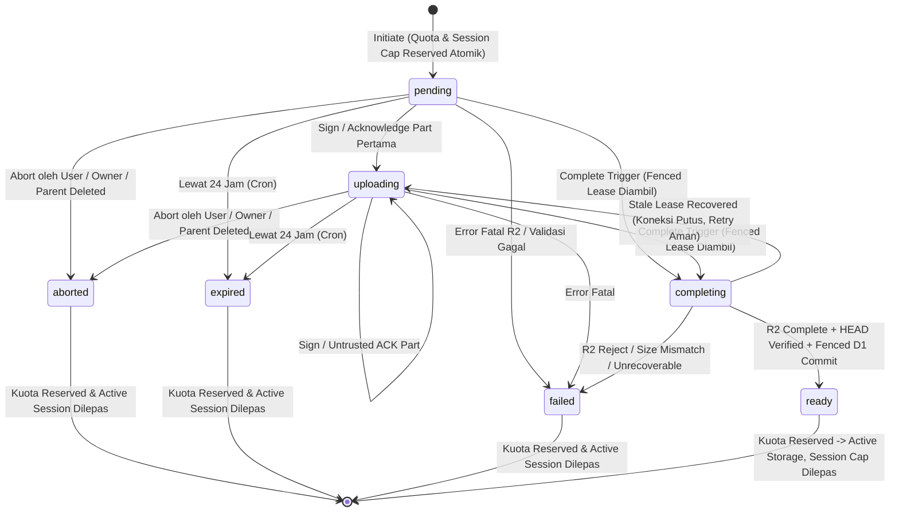
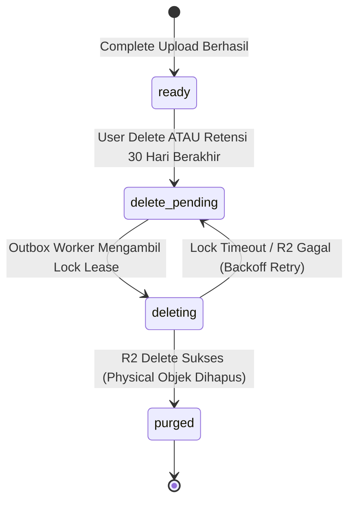

# Desain Arsitektur & Keamanan Cloud Audio Upload (Fase R3A)

Dokumen ini mendefinisikan arsitektur teknis, model keamanan, kontrak API, mesin status (*state machine*), rancangan skema database D1 (`0005`), manajemen siklus hidup objek Cloudflare R2, serta pagar pembatas biaya (*cost guardrails*) untuk fitur Cloud Audio Upload pada platform Catetin (rename-ready).

Dokumen ini merupakan spesifikasi arsitektur final hasil evaluasi menyeluruh yang menjadi acuan langsung bagi fase **R3B (Infrastructure & Data Contracts)**, **R3C (Upload Engine, API, & Cleanup)**, **R3D (Browser Client Integration)**, dan **R3 Release Gate**.

> **Prinsip Utama Local-First:** Jalur Cloud Audio Upload merupakan kapabilitas opsional tambahan bagi pengguna terautentikasi dengan hak akses (*entitlement*) cloud aktif. Seluruh fitur perekaman, penyimpanan lokal IndexedDB, dan transkripsi lokal di perangkat (*on-device WebGPU/WASM*) tetap menjadi fondasi utama yang bekerja mandiri tanpa ketergantungan pada cloud.

---

## 1. Tujuan, Non-Goals, dan Batas Scope

### 1.1. Tujuan Utama
1. **Direct-to-R2 Multipart Upload Tanpa Proxy Worker:** Mengunggah berkas audio besar (hingga batas private alpha 2 GiB / 4 jam) langsung dari peramban ke Cloudflare R2 private bucket menggunakan S3-compatible presigned `UploadPart` URLs. Aliran biner audio tidak membebani batas memori (128 MB) maupun durasi eksekusi Cloudflare Worker.
2. **Kontrol Otoritatif di Worker & D1:** Cloudflare Worker bertindak sebagai *control plane* yang memvalidasi sesi Better Auth, menegakkan RBAC workspace, mengelola reservasi kuota atomik bebas TOCTOU, membatasi active upload sessions secara atomik, menerbitkan sesi upload, menandatangani presigned URL berumur pendek, memverifikasi integritas part di D1, dan mencatat aset serta log sinkronisasi secara transaksional.
3. **Resumability Tangguh dengan Reselect-and-Verify & Versioned Fingerprint:** Mendukung part standar 8 MiB dengan batas 3 part paralel. Resume sesi pasca-reload peramban mewajibkan verifikasi ulang berkas lokal (*reselect-and-verify*) menggunakan fingerprint terstruktur (*sampled byte ranges*), mencocokkan ukuran dan hash part terhadap catatan kanonikal D1 sebelum melanjutkan upload.
4. **Bucket Privat & Opaque Object Key:** Bucket R2 (`workspace-audio-prod`) berstatus privat tanpa akses publik. Seluruh kunci objek (`r2_key`) berformat acak kriptografis netral tanpa memuat PII, nama berkas, judul rekaman, atau identitas tenant.
5. **Siklus Retensi Dinamis & Grace Period 30 Hari:** Retensi bawaan adalah 30 hari. Retensi `until_deleted` tunduk pada kuota paket berbayar aktif. Apabila masa aktif paket berakhir, aset `until_deleted` tidak langsung dihapus melainkan memperoleh masa tenggang (*grace period*) 30 hari sebelum dijadwalkan untuk dibersihkan.
6. **Independensi Transkrip & Proyek:** Penghapusan audio (baik manual maupun otomatis) tidak pernah menghapus rekaman, folder, proyek, pembicara, tag, atau naskah transkrip di D1.

### 1.2. Non-Goals
- Tidak menyediakan kuota penyimpanan cloud permanen pada tier Free (fitur cloud memerlukan entitlement aktif: Coba, Plus, Pro, Team, atau Top-up).
- Tidak memproxy biner audio melalui Worker pada alur upload maupun playback.
- Tidak menjalankan pipeline transkripsi AI cloud (ASR) pada fase R3 (pemrosesan cloud ASR dialokasikan ke fase R4).
- Tidak mengizinkan mutasi langsung entitas `audio_asset` melalui endpoint generik `POST /api/workspaces/:workspaceId/mutations`.
- Tidak menulis kode produksi, file migrasi SQL, modifikasi `wrangler.jsonc`, atau pembuatan bucket R2 pada fase R3A ini.

---

## 2. Verifikasi Dokumentasi Resmi Cloudflare R2 & Batasan Platform

Desain ini berpijak pada dokumentasi resmi Cloudflare R2 (*Limits*, *S3 API Compatibility*, *Presigned URLs*, *CORS*, dan *Lifecycles*):

1. **Batas Ukuran & Jumlah Part Multipart R2:**
   - Ukuran maksimum satu objek: 5 TiB (4.995 TiB).
   - Ukuran part minimum: 5 MiB (5.242.880 byte), kecuali part terakhir yang boleh berukuran < 5 MiB (>= 1 byte).
   - Ukuran part maksimum: 5 GiB per part.
   - Jumlah part maksimum: 10.000 part per multipart upload.
   - Dengan part tetap 8 MiB (8.388.608 byte) dan batas berkas 2 GiB (2.147.483.648 byte), jumlah part berkisar antara 1 hingga 256 part (jauh di bawah batas 10.000 part).
2. **Aturan Keseragaman Ukuran Part R2 (Kekhususan S3 R2):**
   - Cloudflare R2 mewajibkan seluruh part non-terakhir memiliki panjang byte yang seragam (*uniform part size*). Jika part non-terakhir memiliki ukuran berbeda, panggilan `CompleteMultipartUpload` ditolak dengan error `400 InvalidPart` ("All non-trailing parts must have the same length").
   - Server mengunci `part_size_bytes = 8388608` (8 MiB) pada inisiasi dan menolak penyelesaian jika part non-terakhir menyimpang dari ukuran tersebut.
3. **Presigning & Structured URL Construction:**
   - Native binding Worker (`env.AUDIO_BUCKET`) mendukung `createMultipartUpload`, `resumeMultipartUpload`, `head`, dan `delete` di internal jaringan Cloudflare, tetapi tidak dapat menandatangani presigned URL S3.
   - Worker menggunakan pustaka ringan `aws4fetch` (`AwsClient`) untuk menandatangani URL presigned `PUT` (UploadPart) dan `GET` (Playback) terhadap endpoint S3 R2 (`https://<ACCOUNT_ID>.r2.cloudflarestorage.com`) dengan `region: "auto"` dan `service: "s3"`.
   - Penyusunan URL presigned **WAJIB** menggunakan objek standar `URL` dan `URLSearchParams` terstruktur, bukan penggabungan string manual dengan `encodeURIComponent(uploadId)`. Pustaka `aws4fetch` melakukan canonical query signing langsung dari parsed URL parameters satu kali tanpa risiko *double-encoding*.
4. **Lifecycle & CORS Bucket:**
   - Aturan lifecycle bucket: *Abort Incomplete Multipart Uploads* disetel 7 hari sebagai batas pengaman infrastruktur terhadap part yatim (*orphaned parts*).
   - CORS bucket wajib mengekspos header `ETag` (`ExposeHeaders: ["ETag", "Content-Length", "Content-Range", "Accept-Ranges"]`) agar peramban dapat membaca ETag hasil `PUT`.

---

## 3. Perbandingan Pendekatan Arsitektur Upload

| Kriteria | Opsi 1: Worker Proxy | Opsi 2: Direct Multipart R2 (Dipilih) | Opsi 3: TUS / Durable Objects |
| :--- | :--- | :--- | :--- |
| **Aliran Biner** | Peramban -> Worker -> R2 | Peramban -> R2 (Direct via Presigned PUT) | Peramban -> Coordinator DO -> R2 |
| **Batas Memori Worker** | Rentan Out-Of-Memory (128 MB cap) pada file 2 GiB | Beban memori Worker mendekati nol (hanya JSON kontrol) | State koordinasi tersimpan di DO; biaya memori tinggi |
| **Biaya Eksekusi** | Durasi CPU & subrequest Worker sangat mahal | Sangat murah: 0 biaya egress R2, operasi Worker minimal | Biaya tambahan untuk durasi eksekusi Durable Object |
| **Resumability** | Rumit; membutuhkan buffering chunk kustom di Worker | Native S3 Multipart: retry per part 8 MiB independen | Sangat baik, namun menduplikasi kapabilitas native S3 |
| **Kompatibilitas Klien** | Khusus web; sulit untuk background upload Android | Standar HTTP PUT per part; kompatibel web dan Android | Membutuhkan dependensi pustaka klien TUS |

---

## 4. Arsitektur Komponen: Control Plane vs Data Plane

```text
+-----------------------------------------------------------------------------------+
|                                  BROWSER CLIENT                                   |
|  - Fixed 8 MiB Slicing, Max 3 Parallel Uploads                                    |
|  - Reselect-and-Verify File Checker (Match Versioned Sampled Fingerprint)         |
|  - Retry Queue, Presigned Refresh Manager, & Untrusted ACK Dispatcher             |
+-----------------------------------------+-----------------------------------------+
                                          |
                   1. Control Plane       |       2. Data Plane (Direct Binary)
                   (JSON over HTTPS,      |       (Structured Presigned PUT &
                    Cookie Session,       |        Presigned GET Playback,
                    Trusted Origin)       |        CORS Terkunci)
                                          v                                         v
+-----------------------------------------+---------+     +-------------------------+---------+
|                 CLOUDFLARE WORKER                 |     |      PRIVATE R2 BUCKET            |
|  - Better Auth Session & Trusted Origin Guard     |     |  - Name: workspace-audio-prod     |
|  - Workspace RBAC & Session Ownership Guard       |     |  - Public Access: DISABLED        |
|  - Approximate Rate Limiter Binding (Adapter)     |     |  - Opaque Key Structure           |
|  - Atomic Quota & Active Session Ledger           |     |  - Lifecycle: Abort Incomplete    |
|  - D1 Canonical Part Ledger                       |     |    Multipart after 7 days         |
|  - Fenced Completion Lease & Attempt Recovery     |     |                                   |
|  - Structured Presigner (aws4fetch S3 Signer)     |     |                                   |
|  - Native R2 Binding (create/complete/abort/head) |     |                                   |
+-------------------------+-------------------------+     +-------------------------+---------+
                          |                                                         ^
                          | 3. Atomic D1 Mutations & Outbox Dispatch                |
                          v                                                         |
+-------------------------+-------------------------+     +-------------------------+---------+
|                   CLOUDFLARE D1                   |     |     SCHEDULED CLEANUP WORKER      |
|  - audio_upload_session (Anti-Cascade & Fence)    |     |     (Cron Trigger Terjadwal)      |
|  - audio_upload_part (Canonical Ledger)           |     |  - Abort Sesi Stale / Expired     |
|  - audio_asset (Partial Unique Index)             |     |  - Fenced Lease Stale Recovery    |
|  - transaction_guard (In-Batch Executable Abort)  |     |  - Outbox Physical Deletion       |
|  - audio_cleanup_outbox (Durable Deletion)        |     |  - 30-Day Retention & Grace Purge |
|  - workspace_storage_quota (Atomic Ledger & Cap)  |     |                                   |
|  - workspace_change_log & mutation_idempotency    |     |                                   |
+---------------------------------------------------+     +-----------------------------------+
```

---

## 5. Interoperability Spike (Gate Wajib Sebelum R3B)

Sebelum menulis migrasi SQL atau kode fitur lengkap di R3B, tim engineering wajib mengeksekusi **Technical Spike** terisolasi di Cloudflare Worker development environment:

1. **Tujuan Spike:**
   - Memvalidasi secara empiris bahwa `uploadId` yang dihasilkan oleh native binding Worker (`env.AUDIO_BUCKET.createMultipartUpload(key)`) dapat menerima part yang diunggah menggunakan presigned URL buatan `aws4fetch`.
   - Memvalidasi bahwa `CompleteMultipartUpload` melalui native binding Worker (`env.AUDIO_BUCKET.resumeMultipartUpload(key, uploadId).complete(parts)`) berhasil merakit part yang diunggah via presigned URL tersebut.
   - **Encoding Interoperability Case:** Memvalidasi bahwa `uploadId` yang memuat karakter khusus seperti `+`, `/`, `=`, dan spasi ditangani secara terstruktur via `URL` dan `URLSearchParams` tanpa double-encoding, menghasilkan tandatangan AWS SigV4 yang valid dan diterima R2 dengan HTTP 200.
   - Memverifikasi bahwa header `ETag` dikembalikan secara bersih oleh R2 dan dapat dibaca peramban melalui konfigurasi CORS.
2. **Kriteria Kelulusan Spike:**
   - File contoh (misal 18 MiB = 2 part @ 8 MiB + 1 part @ 2 MiB) berhasil diunggah langsung ke presigned URL R2 dan dirakit secara sempurna tanpa error `SignatureDoesNotMatch` atau `InvalidPart`.
   - Panggilan `env.AUDIO_BUCKET.head(key)` memastikan ukuran objek R2 tepat sama dengan 18 MiB.
   - Jika spike menemukan ketidakcocokan runtime, solusi interoperabilitas harus diselesaikan sebelum skema R3B dikunci.

---

## 6. State Machine & Siklus Hidup Audio

### 6.1. State Machine Sesi Upload (`audio_upload_session.status`)


### 6.2. State Machine Penyimpanan Aset Audio (`audio_asset.storage_state`)


- **Pemisahan Status:** Status `purged` **hanya** disematkan setelah penghapusan fisik di R2 benar-benar sukses dikonfirmasi oleh outbox worker. Sebelum penghapusan fisik selesai, aset berada pada status `delete_pending` atau `deleting`.

---

## 7. Diagram Alur Tekstual & Sequence Flows

### 7.1. Initiate Upload, Quota Reservation, & Active Session Cap
```text
Browser                          Worker                             D1 (Database)                    R2 Bucket
  |                                |                                      |                              |
  |-- POST .../initiate ---------->|                                      |                              |
  |   (mime, size, duration,       |-- 1. Auth-first, Origin, & Limiter ->|                              |
  |    fingerprintVersion,         |-- 2. Validasi MIME & Batas 2 GiB     |                              |
  |    fingerprintValue)           |-- 3. Atomic Quota & Session Cap:     |                              |
  |                                |      UPDATE workspace_storage_quota  |                              |
  |                                |      SET reserved_bytes = ...,       |                              |
  |                                |          active_upload_sessions += 1 |                              |
  |                                |      WHERE quota_ok AND cap < 3 ---->|                              |
  |                                |      + INSERT transaction_guard ---->| (Rollback jika zero-row)     |
  |                                |<-- Changes = 1 (Cap & Quota Secured)-|                              |
  |                                |-- 4. createMultipartUpload(r2_key) --|----------------------------->|
  |                                |<-- Return r2_upload_id --------------|------------------------------|
  |                                |-- 5. Insert audio_upload_session --->|                              |
  |                                |      (status: 'pending')             |                              |
  |                                |-- 6. Sign Structured Presigned PUTs  |                              |
  |<-- 200 OK (sessionId,          |      (Part 1..3, TTL 900s)           |                              |
  |    partSize=8MiB, URLs) -------|                                      |                              |
```

### 7.2. Reselect-and-Verify Resume Flow (Pasca-Reload Peramban)
```text
Pengguna / Peramban               Worker                             D1 (Database)
  |                                 |                                      |
  | [Pengguna Reload Halaman]       |                                      |
  | Klien membaca local session ID  |                                      |
  |-- GET .../uploads/:id --------->|                                      |
  |<-- 200 OK (session metadata,    |-- Query session & canonical parts -->|
  |    uploadedParts from D1) ------|<-- status, size, fingerprint, parts -|
  |                                 |                                      |
  | 1. UI menampilkan prompt:       |                                      |
  |    "Pilih kembali berkas untuk  |                                      |
  |     melanjutkan unggahan"       |                                      |
  | 2. Pengguna memilih berkas      |                                      |
  | 3. Klien kalkulasi fingerprint: |                                      |
  |    - file.size == session.size  |                                      |
  |    - file.type == session.mime  |                                      |
  |    - Sample 3x 64KiB slices     |                                      |
  |    - Hash SHA-256 v1 cocok      |                                      |
  | 4. Jika cocok -> Klien lanjut   |                                      |
  |    unggah hanya part yang belum |                                      |
  |    tercatat di D1               |                                      |
  | 5. Jika tidak cocok -> Tolak    |                                      |
  |    lokal, jangan upload part    |                                      |
```

### 7.3. Complete Upload dengan Fenced Completion Lease
```text
Browser                          Worker                             D1 (Database)                    R2 Bucket
  |                                |                                      |                              |
  |-- POST .../complete ---------->|                                      |                              |
  |   (clientMutationId)           |-- 1. Fenced Lease CAS:               |                              |
  |                                |      UPDATE audio_upload_session     |                              |
  |                                |      SET status = 'completing',      |                              |
  |                                |          completion_lease_token=UUID,|                              |
  |                                |          lease_expires_at = now+60s  |                              |
  |                                |      WHERE status in ('pending',     |                              |
  |                                |      'uploading') OR expired_lease ->|                              |
  |                                |<-- Changes = 1 (Lease Fenced) -------|                              |
  |                                |                                      |                              |
  |                                |-- 2. Ambil Parts Kanonikal D1:       |                              |
  |                                |      SELECT * FROM audio_upload_part |                              |
  |                                |      WHERE session_id = ? ---------->|                              |
  |                                |<-- Canonical Parts List -------------|                              |
  |                                |-- 3. Verifikasi jumlah & ukuran part |                              |
  |                                |-- 4. CompleteMultipartUpload(D1parts)|----------------------------->|
  |                                |<-- R2 Assembly OK -------------------|------------------------------|
  |                                |-- 5. HEAD Object(r2_key) ------------|----------------------------->|
  |                                |<-- Size riil R2 terverifikasi -------|------------------------------|
  |                                |-- 6. Transaksi Atomik D1 (db.batch): |                              |
  |                                |      - Update session = 'ready'      |                              |
  |                                |        WHERE token = attempt_token   |                              |
  |                                |      - Insert transaction_guard      |                              |
  |                                |      - Insert audio_asset (ready)    |                              |
  |                                |      - Storage quota: reserved ->    |                              |
  |                                |        used, session cap -= 1        |                              |
  |                                |      - Insert workspace_change_log   |                              |
  |                                |      - Insert idempotency record --->|                              |
  |<-- 200 OK (audioAsset DTO) ----|                                      |                              |
```

---

## 8. Kontrak Endpoint Usulan & Request/Response Envelope

### 8.1. D1 sebagai Sumber Kanonikal Part (Untrusted Client ACK)
Klien **tidak boleh** mengirimkan daftar part pengganti pada payload endpoint `complete`. Daftar part yang dirakit ke R2 diambil langsung dari tabel kanonikal `audio_upload_part` di D1.
- Klien mengirim laporan part selesai (*ACK*) melalui endpoint `/parts/sign` atau saat meminta sign part berikutnya.
- ACK klien diperlakukan sebagai petunjuk (*untrusted hint*). Server memvalidasi ETag dan ukuran part.
- Jika ada ACK yang bertentangan untuk `partNumber` yang sama (misal `partNumber` sama dikirim dengan ETag berbeda), server menolak dengan `409 CONFLICT` (`PART_ETAG_CONFLICT`).

### 8.2. Rincian Endpoint Kontrol

#### Endpoint 1: Initiate Upload Session
- **Metode & Path:** `POST /api/workspaces/:workspaceId/recordings/:recordingId/audio-uploads/initiate`
- **Request Envelope:**
```json
{
  "clientMutationId": "mut_init_01J9X8K2M...",
  "mimeType": "audio/webm",
  "sizeBytes": 25165824,
  "durationSec": 1840.5,
  "fingerprintVersion": "v1",
  "fingerprintValue": "e3b0c44298fc1c149afbf4c8996fb92427ae41e4649b934ca495991b7852b855",
  "retentionTier": "30_days",
  "initialPartNumbers": [1, 2, 3]
}
```
- **Response `200 OK` Envelope:**
```json
{
  "uploadSession": {
    "id": "aus_01J9X8K2M...",
    "workspaceId": "ws_01J9...",
    "recordingId": "rec_01J9...",
    "initiatedByUserId": "usr_01J9...",
    "status": "pending",
    "mimeType": "audio/webm",
    "sizeBytes": 25165824,
    "durationSec": 1840.5,
    "fingerprintVersion": "v1",
    "fingerprintValue": "e3b0c44298fc1c149afbf4c8996fb92427ae41e4649b934ca495991b7852b855",
    "metadataVerified": false,
    "partSizeBytes": 8388608,
    "totalParts": 3,
    "retentionTier": "30_days",
    "expiresAt": 1762790400000,
    "createdAt": 1762704000000,
    "updatedAt": 1762704000000
  },
  "presignedParts": [
    {
      "partNumber": 1,
      "expectedSizeBytes": 8388608,
      "uploadUrl": "https://<account>.r2.cloudflarestorage.com/workspace-audio-prod/v1/audio/...?partNumber=1&uploadId=...&X-Amz-Signature=...",
      "expiresAt": 1762704900000
    },
    {
      "partNumber": 2,
      "expectedSizeBytes": 8388608,
      "uploadUrl": "https://<account>.r2.cloudflarestorage.com/workspace-audio-prod/v1/audio/...?partNumber=2&uploadId=...&X-Amz-Signature=...",
      "expiresAt": 1762704900000
    },
    {
      "partNumber": 3,
      "expectedSizeBytes": 8388608,
      "uploadUrl": "https://<account>.r2.cloudflarestorage.com/workspace-audio-prod/v1/audio/...?partNumber=3&uploadId=...&X-Amz-Signature=...",
      "expiresAt": 1762704900000
    }
  ]
}
```

#### Endpoint 2: Sign / Refresh Presigned Part URLs & Untrusted ACK
- **Metode & Path:** `POST /api/workspaces/:workspaceId/audio-uploads/:uploadSessionId/parts/sign`
- **Request Envelope:**
```json
{
  "partNumbers": [4, 5, 6],
  "partAcks": [
    {
      "partNumber": 1,
      "etag": "\"d41d8cd98f00b204e9800998ecf8427e\"",
      "sizeBytes": 8388608
    },
    {
      "partNumber": 2,
      "etag": "\"0cc175b9c0f1b6a831c399e269772661\"",
      "sizeBytes": 8388608
    }
  ]
}
```
- **Response `200 OK` Envelope:**
```json
{
  "uploadSessionId": "aus_01J9X8K2M...",
  "status": "uploading",
  "acknowledgedParts": [1, 2],
  "presignedParts": [
    {
      "partNumber": 4,
      "expectedSizeBytes": 8388608,
      "uploadUrl": "https://...",
      "expiresAt": 1762705800000
    },
    {
      "partNumber": 5,
      "expectedSizeBytes": 8388608,
      "uploadUrl": "https://...",
      "expiresAt": 1762705800000
    },
    {
      "partNumber": 6,
      "expectedSizeBytes": 8388608,
      "uploadUrl": "https://...",
      "expiresAt": 1762705800000
    }
  ]
}
```

#### Endpoint 3: Inspect / Resume Upload Session
- **Metode & Path:** `GET /api/workspaces/:workspaceId/audio-uploads/:uploadSessionId`
- **Response `200 OK` Envelope:**
```json
{
  "uploadSession": {
    "id": "aus_01J9X8K2M...",
    "workspaceId": "ws_01J9...",
    "recordingId": "rec_01J9...",
    "initiatedByUserId": "usr_01J9...",
    "status": "uploading",
    "mimeType": "audio/webm",
    "sizeBytes": 25165824,
    "durationSec": 1840.5,
    "fingerprintVersion": "v1",
    "fingerprintValue": "e3b0c44298fc1c149afbf4c8996fb92427ae41e4649b934ca495991b7852b855",
    "metadataVerified": false,
    "partSizeBytes": 8388608,
    "totalParts": 3,
    "retentionTier": "30_days",
    "expiresAt": 1762790400000,
    "createdAt": 1762704000000,
    "updatedAt": 1762704300000
  },
  "canonicalParts": [
    {
      "partNumber": 1,
      "etag": "d41d8cd98f00b204e9800998ecf8427e",
      "sizeBytes": 8388608,
      "uploadedAt": 1762704120000
    },
    {
      "partNumber": 2,
      "etag": "0cc175b9c0f1b6a831c399e269772661",
      "sizeBytes": 8388608,
      "uploadedAt": 1762704180000
    }
  ]
}
```

#### Endpoint 4: Complete Multipart Upload
- **Metode & Path:** `POST /api/workspaces/:workspaceId/audio-uploads/:uploadSessionId/complete`
- **Request Envelope:**
```json
{
  "clientMutationId": "mut_comp_01J9X9..."
}
```
*(Catatan: Klien tidak mengirimkan daftar part; server merakit berdasarkan data kanonikal di D1).*
- **Response `200 OK` Envelope:**
```json
{
  "uploadSession": {
    "id": "aus_01J9X8K2M...",
    "status": "ready",
    "completedAt": 1762704500000
  },
  "audioAsset": {
    "id": "aud_01J9X9A...",
    "recordingId": "rec_01J9...",
    "workspaceId": "ws_01J9...",
    "mimeType": "audio/webm",
    "sizeBytes": 25165824,
    "durationSec": 1840.5,
    "metadataVerified": false,
    "retentionTier": "30_days",
    "purgeAt": 1765296500000,
    "storageState": "ready",
    "version": 1,
    "createdAt": 1762704500000,
    "updatedAt": 1762704500000
  },
  "sync": {
    "changeSeq": 42,
    "operation": "upsert",
    "version": 1,
    "changedAt": 1762704500000
  }
}
```

#### Endpoint 5: Abort Upload Session
- **Metode & Path:** `POST /api/workspaces/:workspaceId/audio-uploads/:uploadSessionId/abort`
- **Request Envelope:**
```json
{
  "clientMutationId": "mut_abort_01J9X9..."
}
```
- **Response `200 OK` Envelope:**
```json
{
  "uploadSession": {
    "id": "aus_01J9X8K2M...",
    "status": "aborted",
    "abortedAt": 1762704600000
  }
}
```

#### Endpoint 6: Playback Authorization
- **Metode & Path:** `POST /api/workspaces/:workspaceId/recordings/:recordingId/audio/playback`
- **Request Envelope:**
```json
{}
```
- **Response `200 OK` Envelope:**
```json
{
  "playback": {
    "audioAssetId": "aud_01J9X9A...",
    "recordingId": "rec_01J9...",
    "mimeType": "audio/webm",
    "sizeBytes": 25165824,
    "durationSec": 1840.5,
    "url": "https://<account>.r2.cloudflarestorage.com/workspace-audio-prod/v1/audio/...?X-Amz-Expires=900&X-Amz-Signature=...",
    "expiresAt": 1762705500000
  }
}
```

#### Endpoint 7: Delete Audio Asset
- **Metode & Path:** `DELETE /api/workspaces/:workspaceId/recordings/:recordingId/audio`
- **Request Envelope:**
```json
{
  "clientMutationId": "mut_del_aud_01J9XA...",
  "expectedVersion": 1
}
```
- **Response `200 OK` Envelope:**
```json
{
  "deleted": true,
  "audioAssetId": "aud_01J9X9A...",
  "recordingId": "rec_01J9...",
  "workspaceId": "ws_01J9...",
  "storageState": "delete_pending",
  "sync": {
    "changeSeq": 43,
    "entityType": "audio_asset",
    "entityId": "aud_01J9X9A...",
    "operation": "delete",
    "version": 2,
    "changedAt": 1762706000000
  }
}
```

---

## 9. Matriks Otorisasi (RBAC & Session Ownership Matrix)

Untuk mencegah eskalasi hak istimewa atau intervensi antar-anggota dalam workspace tim:

| Aksi / Endpoint | Initiator Sesi (`initiated_by_user_id`) | Anggota Lain (`role: member`) | Admin Workspace (`role: admin`) | Pemilik Workspace (`role: owner`) | Non-Anggota Workspace |
| :--- | :--- | :--- | :--- | :--- | :--- |
| **Initiate Upload** | Diizinkan | Diizinkan (membuat sesi baru) | Diizinkan | Diizinkan | 404 Not Found (Anti-Enum) |
| **Sign Parts** | **Hanya Diizinkan** | Ditolak (403 FORBIDDEN) | Ditolak (403 FORBIDDEN) | Ditolak (403 FORBIDDEN) | 404 Not Found |
| **Inspect / Resume** | Diizinkan | Ditolak (403 FORBIDDEN) | Ditolak (403 FORBIDDEN) | Diizinkan (Read Audit) | 404 Not Found |
| **Complete Upload** | **Hanya Diizinkan** | Ditolak (403 FORBIDDEN) | Ditolak (403 FORBIDDEN) | Ditolak (403 FORBIDDEN) | 404 Not Found |
| **Abort Sesi Upload** | Diizinkan | Ditolak (403 FORBIDDEN) | Ditolak (403 FORBIDDEN) | Diizinkan (Admin Abort) | 404 Not Found |
| **Playback Audio** | Diizinkan | Diizinkan | Diizinkan | Diizinkan | 404 Not Found |
| **Delete Audio Asset** | Diizinkan (jika creator) | Ditolak (kecuali creator) | Diizinkan (Admin Delete) | Diizinkan (Owner Delete) | 404 Not Found |

- **Prinsip Session Ownership:** Hanya pengguna yang menginisiasi sesi (`initiated_by_user_id`) yang berhak menandatangani presigned part URL dan menyelesaikan unggahan. Pemilik workspace (`owner`) hanya memiliki hak administratif untuk membatalkan sesi macet (*administrative abort*) atau menghapus audio yang sudah selesai (*administrative delete*).

---

## 10. Strategi Opaque Object Key & Bucket Naming

1. **Nama Bucket R2 Netral & Rename-Ready:**
   - Nama bucket: `workspace-audio-prod` (dengan binding Worker `AUDIO_BUCKET`).
   - Lingkungan pengujian / dev: `workspace-audio-dev`.
   - Tidak menggunakan string brand tertentu demi keluwesan identitas produk.
2. **Format Kunci Objek Opaque:**
   ```text
   v1/audio/<shard_hex_2>/<opaque_asset_uuid_v4>
   ```
   Contoh:
   ```text
   v1/audio/4a/c8f2b3e1-9d10-4e56-b072-3c12f489a105
   ```
   - Bebas dari PII, ID tenant, ID rekaman, nama berkas, maupun ekstensi.
   - Menggunakan 122 bit entropi kriptografis CSPRNG.

---

## 11. Spesifikasi Skema Database D1 (Migration 0005 Design)

Skema dirancang memenuhi seluruh hard gate, integritas transaksional, penanganan fenced lease, proteksi anti-cascade, dan pembatasan sesi aktif atomik:

```sql
-- 1. Kuota Penyimpanan Workspace & Ledger Atomik Bebas TOCTOU
CREATE TABLE IF NOT EXISTS workspace_storage_quota (
    workspace_id TEXT PRIMARY KEY,
    quota_limit_bytes INTEGER NOT NULL DEFAULT 0,
    used_bytes INTEGER NOT NULL DEFAULT 0,
    reserved_bytes INTEGER NOT NULL DEFAULT 0,
    pending_purge_bytes INTEGER NOT NULL DEFAULT 0,
    active_upload_sessions INTEGER NOT NULL DEFAULT 0,
    version INTEGER NOT NULL DEFAULT 1,
    updated_at INTEGER NOT NULL,
    CHECK (quota_limit_bytes >= 0),
    CHECK (used_bytes >= 0),
    CHECK (reserved_bytes >= 0),
    CHECK (pending_purge_bytes >= 0),
    CHECK (active_upload_sessions >= 0 AND active_upload_sessions <= 3),
    FOREIGN KEY (workspace_id) REFERENCES workspace(id) ON DELETE CASCADE
);

-- 2. Tabel Guard Eksekusi Batch Transaksional SQLite/D1
CREATE TABLE IF NOT EXISTS transaction_guard (
    guard_id TEXT PRIMARY KEY,
    assert_value INTEGER NOT NULL CHECK (assert_value = 1)
);

-- 3. Sesi Multipart Upload Audio (Anti-Cascade & Fenced Lease)
CREATE TABLE IF NOT EXISTS audio_upload_session (
    id TEXT PRIMARY KEY,
    workspace_id TEXT NOT NULL,
    recording_id TEXT NOT NULL,
    initiated_by_user_id TEXT NOT NULL,
    client_mutation_id TEXT NOT NULL,
    request_hash TEXT NOT NULL,
    r2_key TEXT NOT NULL UNIQUE,
    r2_upload_id TEXT NOT NULL,
    mime_type TEXT NOT NULL CHECK(mime_type IN ('audio/wav', 'audio/mpeg', 'audio/mp4', 'audio/webm')),
    declared_size_bytes INTEGER NOT NULL CHECK(declared_size_bytes > 0 AND declared_size_bytes <= 2147483648),
    declared_duration_sec REAL NOT NULL CHECK(declared_duration_sec > 0 AND declared_duration_sec <= 14400),
    fingerprint_version TEXT NOT NULL DEFAULT 'v1',
    fingerprint_value TEXT NOT NULL,
    metadata_verified INTEGER NOT NULL DEFAULT 0 CHECK(metadata_verified IN (0, 1)),
    part_size_bytes INTEGER NOT NULL DEFAULT 8388608 CHECK(part_size_bytes >= 5242880),
    total_parts INTEGER NOT NULL CHECK(total_parts >= 1 AND total_parts <= 256),
    retention_tier TEXT NOT NULL DEFAULT '30_days' CHECK(retention_tier IN ('30_days', 'until_deleted')),
    status TEXT NOT NULL CHECK(status IN ('pending', 'uploading', 'completing', 'ready', 'failed', 'aborted', 'expired')),
    completion_lease_token TEXT,
    completion_lease_expires_at INTEGER,
    failure_code TEXT,
    created_at INTEGER NOT NULL,
    updated_at INTEGER NOT NULL,
    expires_at INTEGER NOT NULL,
    completed_at INTEGER,
    aborted_at INTEGER,
    -- Catatan Arsitektur: Hubungan ke recording menggunakan ON DELETE RESTRICT (Anti-Cascade).
    -- Upload session tetap menyimpan workspace_id, recording_id, r2_key, dan r2_upload_id
    -- utuh meskipun recording di-soft-delete atau dicoba di-hard-delete, hingga proses abort
    -- atau cleanup fisik R2 selesai tuntas.
    FOREIGN KEY (workspace_id, recording_id) REFERENCES recording(workspace_id, id) ON DELETE RESTRICT,
    FOREIGN KEY (initiated_by_user_id) REFERENCES "user"("id") ON DELETE RESTRICT,
    UNIQUE (workspace_id, initiated_by_user_id, client_mutation_id)
);
CREATE INDEX IF NOT EXISTS idx_upload_session_active
ON audio_upload_session(workspace_id, recording_id)
WHERE status IN ('pending', 'uploading', 'completing');
CREATE INDEX IF NOT EXISTS idx_upload_session_lease
ON audio_upload_session(status, completion_lease_expires_at)
WHERE status = 'completing';
CREATE INDEX IF NOT EXISTS idx_upload_session_expired
ON audio_upload_session(status, expires_at)
WHERE status IN ('pending', 'uploading');

-- 4. Buku Besar Part Kanonikal D1
CREATE TABLE IF NOT EXISTS audio_upload_part (
    upload_session_id TEXT NOT NULL,
    part_number INTEGER NOT NULL CHECK(part_number >= 1 AND part_number <= 256),
    size_bytes INTEGER NOT NULL CHECK(size_bytes > 0 AND size_bytes <= 8388608),
    etag TEXT NOT NULL,
    uploaded_at INTEGER NOT NULL,
    PRIMARY KEY (upload_session_id, part_number),
    FOREIGN KEY (upload_session_id) REFERENCES audio_upload_session(id) ON DELETE CASCADE
);

-- 5. Modifikasi / Ekstensi audio_asset (Migration 0005)
-- Menambahkan kolom storage_state, metadata_verified, upload_session_id, dan purged_at
-- serta partial unique index untuk satu audio aktif per recording.
ALTER TABLE audio_asset ADD COLUMN upload_session_id TEXT;
ALTER TABLE audio_asset ADD COLUMN storage_state TEXT NOT NULL DEFAULT 'ready' CHECK(storage_state IN ('ready', 'delete_pending', 'deleting', 'purged'));
ALTER TABLE audio_asset ADD COLUMN metadata_verified INTEGER NOT NULL DEFAULT 0 CHECK(metadata_verified IN (0, 1));
ALTER TABLE audio_asset ADD COLUMN purged_at INTEGER;

CREATE UNIQUE INDEX IF NOT EXISTS idx_audio_asset_single_active
ON audio_asset(workspace_id, recording_id)
WHERE deleted_at IS NULL;

-- 6. Outbox Pembersihan Objek R2 (Durable & Anti-Cascade)
CREATE TABLE IF NOT EXISTS audio_cleanup_outbox (
    id TEXT PRIMARY KEY,
    idempotency_key TEXT NOT NULL UNIQUE,
    workspace_id TEXT NOT NULL,
    audio_asset_id TEXT,
    upload_session_id TEXT,
    r2_key TEXT NOT NULL,
    r2_upload_id TEXT,
    action_type TEXT NOT NULL CHECK(action_type IN ('delete_object', 'abort_multipart')),
    reason TEXT NOT NULL CHECK(reason IN ('user_delete', 'retention_expired', 'session_expired', 'session_aborted', 'atomic_replacement', 'account_delete')),
    status TEXT NOT NULL DEFAULT 'pending' CHECK(status IN ('pending', 'processing', 'purged', 'failed')),
    lock_lease_expires_at INTEGER,
    attempt_count INTEGER NOT NULL DEFAULT 0,
    next_retry_at INTEGER NOT NULL,
    last_error TEXT,
    payload_bytes INTEGER NOT NULL DEFAULT 0,
    created_at INTEGER NOT NULL,
    updated_at INTEGER NOT NULL,
    completed_at INTEGER
    -- Catatan Arsitektur: audio_cleanup_outbox SENGAJA TIDAK memiliki FOREIGN KEY CASCADE
    -- ke workspace, recording, atau user agar antrean pembersihan fisik R2 tetap bertahan
    -- dan dieksekusi tuntas meskipun entitas induk dihapus dari sistem.
);
CREATE INDEX IF NOT EXISTS idx_cleanup_outbox_queue
ON audio_cleanup_outbox(status, next_retry_at)
WHERE status IN ('pending', 'processing', 'failed');
```

---

## 12. Transaksionalitas D1 & Penegakan Batch Zero-Row Guard

### Mengapa Pemeriksaan JS Pasca-Batch Bukan Mekanisme Rollback
Pada Cloudflare D1 `db.batch([stmt1, stmt2, ...])`, seluruh daftar pernyataan dikirim dan dieksekusi dalam satu transaksi internal database SQLite.
- Jika pernyataan `UPDATE ... WHERE condition` menghasilkan 0 baris (*zero-row affected*), SQLite **TIDAK** menganggapnya sebagai galat sintaksis atau pelanggaran integritas dan akan terus menjalankan pernyataan berikutnya hingga transaksi di-commit ke disk.
- Melempar galat di kode TypeScript/Worker *setelah* pemanggilan `await db.batch()` selesai **TIDAK DAPAT** membatalkan data yang sudah ter-commit di database.
- Oleh karena itu, kegagalan kondisi prasyarat wajib memicu galat SQL murni **dari dalam transaksi batch itu sendiri** agar SQLite melakukan rollback penuh secara otomatis sebelum batch selesai.
- Pemeriksaan metadata hasil `meta.changes === 1` di kode Worker hanya berfungsi sebagai pertahanan lapis kedua (*defense-in-depth*), bukan mekanisme rollback utama.

### Pola Executable SQL Guard via `transaction_guard`
Untuk memaksa SQLite membatalkan transaksi dari dalam batch saat baris prasyarat bernilai 0, sistem menyisipkan pernyataan guard yang mengevaluasi fungsi SQLite `changes()`. Kolom `assert_value` memiliki kekangan `NOT NULL CHECK (assert_value = 1)`. Apabila pernyataan mutasi sebelumnya menghasilkan 0 perubahan baris, ekspresi `CASE WHEN changes() = 1 THEN 1 ELSE NULL END` mengevaluasi ke `NULL`, memicu galat `SQLITE_CONSTRAINT_NOTNULL` dan membatalkan seluruh batch seketika.

#### Contoh 1: Executable Batch untuk Quota Reservation & Active Session Cap
```sql
-- Pernyataan 1: Mutasi atomik kuota dan penambahan counter active sessions
UPDATE workspace_storage_quota
SET reserved_bytes = reserved_bytes + :declared_size,
    active_upload_sessions = active_upload_sessions + 1,
    version = version + 1,
    updated_at = :now
WHERE workspace_id = :workspace_id
  AND (used_bytes + reserved_bytes + :declared_size) <= quota_limit_bytes
  AND active_upload_sessions < 3;

-- Pernyataan 2: Executable SQL Guard
-- Jika Pernyataan 1 mengubah 0 baris (kuota penuh atau sesi aktif >= 3),
-- changes() bernilai 0, menghasilkan NULL dan menggagalkan seluruh batch D1.
INSERT INTO transaction_guard (guard_id, assert_value)
VALUES (
    :ephemeral_guard_id,
    CASE WHEN changes() = 1 THEN 1 ELSE NULL END
);

-- Pernyataan 3: Insert upload session (hanya dieksekusi jika Pernyataan 1 & 2 lolos)
INSERT INTO audio_upload_session (
    id, workspace_id, recording_id, initiated_by_user_id, client_mutation_id,
    request_hash, r2_key, r2_upload_id, mime_type, declared_size_bytes,
    declared_duration_sec, fingerprint_version, fingerprint_value, metadata_verified,
    part_size_bytes, total_parts, retention_tier, status, created_at, updated_at, expires_at
) VALUES (
    :session_id, :workspace_id, :recording_id, :user_id, :mutation_id,
    :hash, :r2_key, :r2_upload_id, :mime, :size,
    :duration, :fp_v, :fp_val, 0,
    :part_size, :total_parts, :retention, 'pending', :now, :now, :expires_at
);

-- Pernyataan 4: Pembersihan baris guard sementara dalam transaksi yang sama
DELETE FROM transaction_guard WHERE guard_id = :ephemeral_guard_id;
```

#### Contoh 2: Executable Batch untuk Completion Publication dengan Fenced CAS
```sql
-- Pernyataan 1: Fenced CAS update sesi upload menggunakan token aktif
UPDATE audio_upload_session
SET status = 'ready',
    completed_at = :now,
    updated_at = :now
WHERE id = :session_id
  AND status = 'completing'
  AND completion_lease_token = :attempt_token;

-- Pernyataan 2: Executable SQL Guard
-- Jika token lease sudah diambil alih oleh worker lain atau sesi berubah,
-- changes() = 0, memicu SQLITE_CONSTRAINT dan membatalkan seluruh publikasi.
INSERT INTO transaction_guard (guard_id, assert_value)
VALUES (
    :ephemeral_guard_id,
    CASE WHEN changes() = 1 THEN 1 ELSE NULL END
);

-- Pernyataan 3: Publikasi audio_asset (ready)
INSERT INTO audio_asset (
    id, recording_id, workspace_id, r2_key, mime_type, size_bytes,
    duration_sec, metadata_verified, retention_tier, purge_at, storage_state,
    version, created_by_user_id, created_at, updated_at
) VALUES (
    :asset_id, :recording_id, :workspace_id, :r2_key, :mime, :actual_size,
    :duration, 0, :retention, :purge_at, 'ready',
    1, :user_id, :now, :now
);

-- Pernyataan 4: Pemindahan kuota (reserved -> used) dan pengurangan active session
UPDATE workspace_storage_quota
SET reserved_bytes = reserved_bytes - :declared_size,
    used_bytes = used_bytes + :actual_size,
    active_upload_sessions = MAX(0, active_upload_sessions - 1),
    version = version + 1,
    updated_at = :now
WHERE workspace_id = :workspace_id;

-- Pernyataan 5: Insert workspace change log
INSERT INTO workspace_change_log (
    workspace_id, change_seq, entity_type, entity_id, operation,
    patch, changed_at, actor_user_id, client_mutation_id
) VALUES (
    :workspace_id, :next_seq, 'audio_asset', :asset_id, 'upsert',
    :patch_json, :now, :user_id, :mutation_id
);

-- Pernyataan 6: Catat Idempotensi Mutasi
INSERT INTO mutation_idempotency (
    workspace_id, client_mutation_id, request_hash, response_json, created_at
) VALUES (
    :workspace_id, :mutation_id, :req_hash, :resp_json, :now
);

-- Pernyataan 7: Pembersihan baris guard sementara
DELETE FROM transaction_guard WHERE guard_id = :ephemeral_guard_id;
```

---

## 13. Strategi Multipart S3, Structured Presigning, & Kebijakan CORS

1. **Detail Inisiasi & Structured Presigning:**
   - Worker menggunakan `env.AUDIO_BUCKET.createMultipartUpload(r2Key, { httpMetadata: { contentType: mimeType } })`.
   - Presigned URL dihasilkan melalui konstruksi URL terstruktur tanpa manipulasi string manual:
     ```typescript
     const endpoint = new URL(`https://${accountId}.r2.cloudflarestorage.com/${bucketName}/${r2Key}`);
     endpoint.searchParams.set('partNumber', String(partNumber));
     endpoint.searchParams.set('uploadId', r2UploadId);

     const presignedRequest = await awsClient.sign(
       new Request(endpoint.toString(), { method: 'PUT' }),
       { aws: { signQuery: true }, expiresIn: 900 }
     );
     const uploadUrl = presignedRequest.url;
     ```
   - Pustaka `aws4fetch` membaca query parameter terstruktur tersebut dan menghasilkan canonical query signature SigV4 secara deterministik tanpa risiko double-encoding.
2. **CORS Policy Bucket `workspace-audio-prod`:**
```json
[
  {
    "AllowedOrigins": [
      "https://catetin-project.anwars-rizki.workers.dev"
    ],
    "AllowedMethods": [
      "PUT",
      "GET",
      "HEAD"
    ],
    "AllowedHeaders": [
      "Content-Type",
      "If-Match",
      "If-None-Match",
      "Range"
    ],
    "ExposeHeaders": [
      "ETag",
      "Content-Length",
      "Content-Range",
      "Accept-Ranges"
    ],
    "MaxAgeSeconds": 3600
  }
]
```

---

## 14. Validasi Menyeluruh & Unverified Client Metadata

1. **Label Unverified Metadata:**
   - Kolom `metadata_verified` pada `audio_upload_session` dan `audio_asset` bernilai `0` (*unverified*) saat upload selesai.
   - Nilai `durationSec` dan `mimeType` dari klien diterima hanya untuk keperluan rendering antarmuka pengguna sementara, bukan untuk penagihan menit atau jaminan keamanan stream. Verifikasi penuh dilakukan oleh media inspector server pada fase R4 sebelum transkripsi cloud dimulai.
2. **Validasi Strict Format Part:**
   - Nomor part berurutan 1..N tanpa celah.
   - Part 1..(N-1) tepat 8.388.608 byte.
   - Part N berukuran `1 <= bytes <= 8388608`.
   - Total ukuran seluruh part sama persis dengan `declared_size_bytes` dan sama dengan hasil `HEAD` objek di R2 sesudah perakitan.

---

## 15. Threat Model, Residual Risks, & Mitigasi

| Ancaman / Residual Risk | Vektor | Mitigasi Arsitektural |
| :--- | :--- | :--- |
| **Residual Risk: Presigned Bearer URL** | URL presigned `PUT` bersifat bearer token selama 15 menit. Jika tercecer di log jaringan klien, pihak ketiga dapat mengunggah biner ke part tersebut. | TTL dibatasi ketat 15 menit. Presigned URL hanya mengikat satu part spesifik. Saat `complete`, Worker memverifikasi total ukuran objek melalui `HEAD` R2. Objek yang tidak selesai dalam 24 jam otomatis di-abort oleh Worker dan incomplete multipart dibersihkan R2 setelah 7 hari. |
| **Residual Risk: Oversized Part Attack** | Penyerang mengunggah biner > 8 MiB ke presigned PUT URL. | R2 menolak Complete jika part non-terakhir berukuran tidak seragam. Selain itu, verifikasi `head.size === session.declared_size_bytes` oleh Worker akan mendeteksi pembengkakan ukuran dan segera menghapus objek fisik dari R2 serta menandai sesi `failed`. |
| **Conflicting ACK Injection** | Klien jahat mengirim dua ACK berbeda untuk part yang sama guna merusak buku besar D1. | D1 menerapkan verifikasi ETag ketat. Jika `partNumber` sudah tercatat dengan ETag berbeda, server menolak dengan `409 PART_ETAG_CONFLICT`. |
| **Crash Worker saat R2 Complete (Dangling Completion)** | Worker mati setelah memanggil R2 Complete tapi sebelum D1 commit selesai. | Fitur Fenced Completion Lease (60s) dengan `completion_lease_token`. Permintaan complete berikutnya atau cron recovery akan memeriksa R2 via `HEAD`. Jika objek sudah terakit di R2, transaksi D1 diselesaikan secara idempoten menggunakan token baru. Jika kadaluarsa, objek dimasukkan ke outbox penghapusan. |

---

## 16. Kebijakan Retensi, Grace Period 30 Hari, & Atomic Replacement

1. **Atomic Replacement (Final):**
   - Satu rekaman hanya memiliki maksimal satu `audio_asset` aktif (ditegakkan via partial unique index `idx_audio_asset_single_active`).
   - Jika rekaman sudah memiliki audio aktif dan pengguna mengunggah audio baru:
     - Sesi upload baru diinisiasi tanpa membatalkan audio lama.
     - Kuota menghitung: `used_bytes` (audio lama) + `reserved_bytes` (audio baru).
     - Saat sesi baru `complete`, dalam transaksi D1 yang sama: audio lama diubah statusnya menjadi `delete_pending`, audio baru menjadi `ready`, entri outbox dibuat untuk menghapus berkas audio lama di R2, dan selisih kuota direkonsiliasi.
2. **Grace Period 30 Hari untuk `until_deleted`:**
   - Jika pengguna memilih retensi `until_deleted` lalu masa aktif paket Pro/Team berakhir, aset tidak langsung dihapus.
   - Sistem menetapkan masa tenggang (*grace period*) 30 hari: `purge_at = entitlement_ended_at + 30 hari`. Pengguna diberi notifikasi untuk memperbarui paket atau mengunduh rekaman sebelum pembersihan fisik dijalankan.
3. **Lifecycle Anti-Cascade Upload Session Saat Recording Dihapus:**
   - Apabila induk rekaman di-soft-delete (`deleted_at` diset) saat sesi upload masih berlangsung:
     - Tabel `audio_upload_session` mempertahankan integritas data (`workspace_id`, `recording_id`, `r2_key`, `r2_upload_id`) karena dilindungi oleh `ON DELETE RESTRICT`.
     - Setiap pemanggilan lanjutan ke `/parts/sign` atau `/complete` mendeteksi bahwa parent recording sudah non-aktif, menolak request, mengubah status sesi menjadi `aborted`, dan memasukkan tugas `abort_multipart` ke `audio_cleanup_outbox`.
     - Jika peramban ditutup pengguna, Scheduled Cleanup Worker (cron) mendeteksi sesi yang terikat pada recording non-aktif, mengeksekusi abort di R2 via outbox, melepaskan reservasi kuota dan active session cap di D1, lalu mencatat penyelesaian sesi.

---

## 17. Cost Guardrails, Kuota Bebas TOCTOU, Rate Limiting, & Fingerprint Kontrak

### 17.1. Buku Besar Kuota Bebas TOCTOU & Atomic Active Session Cap
Pemeriksaan kuota dan pembatasan maksimal 3 sesi aktif per workspace tidak menggunakan pola rentan *SELECT -> check in JS -> UPDATE*. Seluruh reservasi dilakukan secara atomik langsung di database menggunakan executable SQL guard:
- Kolom `active_upload_sessions` pada `workspace_storage_quota` memiliki kekangan `CHECK (active_upload_sessions >= 0 AND active_upload_sessions <= 3)`.
- Pengurangan `active_upload_sessions` dilakukan secara idempoten saat sesi bertransisi dari status aktif (`pending`, `uploading`, `completing`) ke status terminal (`ready`, `aborted`, `expired`, `failed`) menggunakan ekspresi `MAX(0, active_upload_sessions - 1)`.
- Karena transisi ke status terminal dijaga ketat oleh status CAS, pengurangan kuota counter sesi aktif dipastikan terjadi tepat satu kali per sesi.

### 17.2. Pemisahan Product-Visible Quota vs Pending Physical Deletion
- **Product-Visible Quota:** Begitu audio dihapus (`delete_pending`), `used_bytes` langsung dikurangi di buku besar kuota pengguna agar pengguna dapat segera memanfaatkan kembali kapasitas penyimpanannya.
- **Internal Cost Guard:** Kolom `pending_purge_bytes` melacak byte yang masih mengantre penghapusan fisik di R2. Sistem telemetri memantau metrik ini untuk mencegah penimbunan biaya penyimpanan di level infrastruktur R2.
- **D1 sebagai Single Source of Truth:** Seluruh perhitungan kuota penyimpanan dan batasan sesi bersifat transaksional di Cloudflare D1. KV atau in-memory cache tidak pernah digunakan sebagai sumber kebenaran kuota finansial.

### 17.3. Kontrak Rate Limiting & Abuse Protection
Rate limiting ditujukan murni sebagai perlindungan dari penyalahgunaan (*abuse protection*) dan serangan penolakan layanan (*denial-of-service*):
1. **Binding & Adapter:** Menggunakan Cloudflare Rate Limiting binding (`env.RATE_LIMITER`) atau in-memory sliding window adapter per colo.
2. **Kebijakan Fail-Open vs Fail-Closed:**
   - Endpoint `initiate`: **fail-closed** (jika service rate limiter gagal, tolak request dengan `429/503` demi mencegah banjir alokasi sumber daya R2).
   - Endpoint `parts/sign` & `complete`: **fail-open** (jika service rate limiter bermasalah, izinkan request agar proses upload berkas besar yang sah tidak macet atau korup di tengah jalan).
   - Endpoint `playback`: **fail-closed** (proteksi biaya egress).
3. **Komposisi Kunci (Key Composition):**
   - `initiate`: `ratelimit:initiate:<workspaceId>:<userId>` (maksimal 10 request / jam).
   - `parts/sign`: `ratelimit:sign:<workspaceId>:<sessionId>` (maksimal 60 request / 15 menit).
   - `playback`: `ratelimit:playback:<workspaceId>:<userId>` (maksimal 30 request / 15 menit).
4. **Test Seam untuk Pengujian Deterministik:**
   - Menyediakan interface `RateLimiterAdapter` dengan implementasi `MemoryRateLimiter` agar pengujian unit dan integrasi dapat mengatur ambang batas secara deterministik tanpa dependensi eksternal.

### 17.4. Kontrak Fingerprint Berkas Tunggal (One File Fingerprint Contract)
Menghitung hash SHA-256 menyeluruh (*full-file*) pada berkas hingga 2 GiB di dalam peramban tidak realistis karena dapat membekukan UI dan memakan waktu menit CPU. Oleh karena itu, sistem menetapkan kontrak fingerprint terstruktur berversi (*versioned fingerprint*):
1. **Identitas Versi:** `fingerprint_version = "v1"`.
2. **Komponen Pembentuk Fingerprint:**
   - Ukuran berkas riil dalam byte (`file.size`).
   - Tipe MIME deklarasi (`file.type`).
   - Tiga cuplikan byte berukuran tetap 64 KiB (65.536 byte):
     - Cuplikan 1 (Awal): offset `0` s.d. `65536` (header dan magic bytes container).
     - Cuplikan 2 (Tengah): offset `Math.floor(size / 2) - 32768` s.d. `Math.floor(size / 2) + 32768` (frame audio pertengahan).
     - Cuplikan 3 (Akhir): offset `size - 65536` s.d. `size` (metadata trailer atau index).
3. **Penanganan Berkas Kecil (< 192 KiB):**
   - Jika `file.size < 196608` byte, peramban langsung membaca dan menghitung hash seluruh byte berkas tanpa pemotongan.
4. **Algoritma Hash:**
   - `SHA-256("v1" + ":" + sizeBytes + ":" + mimeType + ":" + hex(slice1) + ":" + hex(slice2) + ":" + hex(slice3))`.
5. **Batas & Tujuan Fingerprint:**
   - Nilai disimpan di kolom `fingerprint_value` pada `audio_upload_session`.
   - **PENTING:** Fingerprint ini **hanya** digunakan untuk mencocokkan kembali berkas lokal saat pengguna memilih ulang berkas (*reselect-and-verify*) setelah halaman di-reload. Fingerprint ini **bukan** bukti kriptografis integritas objek final di R2. Integritas objek final dijamin oleh validasi ETag per part dan verifikasi ukuran riil via `HEAD` di R2.

---

## 18. Panduan Copy Privasi Jujur (Anti-Slop)

Sesuai aturan repositori `AGENTS.md` (tanpa kata bualan, tanpa em dash, dan transparan):
- **Opsi Cloud Audio:** *"Audio Anda disimpan secara privat di penyimpanan cloud untuk sinkronisasi ruang kerja. Secara bawaan, audio disimpan selama 30 hari dan dapat dihapus kapan saja. Naskah transkrip dan catatan proyek Anda tetap tersimpan meskipun audio telah dihapus."*
- **Penghapusan Audio:** *"Akses ke berkas audio telah dicabut dari ruang kerja ini dan berkas dijadwalkan untuk dihapus secara permanen dari penyimpanan cloud. Naskah transkrip dan catatan proyek Anda tetap utuh."*

---

## 19. Observability & Zero-Content Structured Logging

Pencatatan log Worker menggunakan format JSON terstruktur tanpa mengoleksi data pribadi:
- **Boleh Dicatat:** `event`, `uploadSessionId`, `workspaceId`, `recordingId`, `status`, `mimeType`, `sizeBytes`, `partCount`, `durationMs`, `errorCategory`, `completionAttemptId`.
- **Dilarang Dicatat:** Nama berkas lokal pengguna, judul rekaman, isi audio, potongan teks transkrip, email, IP mentah, atau presigned URL lengkap.

---

## 20. Matriks Kegagalan & Kompensasi (Failure & Compensation Matrix)

| Kejadian Kegagalan | Status Sistem | Aksi Kompensasi Otomatis |
| :--- | :--- | :--- |
| **Gagal D1 saat Initiate (R2 createMultipart sukses)** | Part yatim di R2 | Blok `catch` Worker langsung memanggil `multipart.abort()`. |
| **Koneksi Klien Putus di Tengah Part** | Part berhasil tersimpan di D1, part gagal diulang | Klien re-request presigned URL via `/parts/sign` dan mengulang part yang gagal. |
| **Worker Mati saat Memanggil R2 Complete** | Sesi berstatus `completing`, lease 60s aktif | Cron recovery mendeteksi stale lease (`now > completion_lease_expires_at`). Cron men-generate attempt token baru, melakukan `HEAD` ke R2: jika objek sudah ada, D1 diselesaikan (`ready`); jika belum, status dikembalikan ke `uploading`. |
| **Worker Lama Bangun Pasca-Timeout (Stale Worker)** | Worker lama mencoba publish D1 dengan token kadaluarsa | Batch D1 gagal karena `completion_lease_token` tidak cocok, membatalkan publikasi secara atomik via executable zero-row guard. |
| **Ukuran Objek R2 Berbeda dari D1 saat Complete** | Objek R2 tidak valid | Worker memanggil `R2.delete(r2_key)`, sesi diubah menjadi `failed`, kuota reserved dan session cap dibebaskan. |
| **Gagal R2 Delete saat User Menghapus Audio** | `audio_asset` sudah `delete_pending` di D1 | Baris outbox tetap berstatus `pending`. Cron Worker melakukan retry dengan exponential backoff hingga sukses menghapus objek R2. |

---

## 21. Kompatibilitas Web & Android Masa Depan

- Seluruh API kontrol menggunakan HTTP JSON standar dan transfer biner menggunakan structured presigned PUT/GET S3 standar.
- Klien Android di masa depan dapat menggunakan `WorkManager` dan `OkHttp` untuk mengunggah part 8 MiB di latar belakang dengan efisiensi baterai optimal, memanggil inspect untuk resume, serta menangani reselect-and-verify melalui Android Storage Access Framework (SAF) dengan kalkulasi fingerprint versi 1 yang identik.

---

## 22. Rencana Uji Komprehensif (Test Matrix R3B/R3C)

1. **Uji Skema & Transaksionalitas (Migration 0005):**
   - Penegakan partial unique index pada `audio_asset` aktif (`deleted_at IS NULL`).
   - Anti-cascade pada `audio_upload_session` (`ON DELETE RESTRICT` terhadap recording).
   - Anti-cascade pada `audio_cleanup_outbox`.
   - Penegakan batasan `active_upload_sessions` (0..3) pada `workspace_storage_quota`.
   - Executable SQL guard: memastikan kegagalan kondisi CAS / zero-row langsung memicu rollback transaksi batch di SQLite/D1.
2. **Uji Fenced Completion Lease:**
   - **Stale Worker Test:** Worker A mengambil lease (token A), mengalami stall > 60s, Worker B mengambil lease baru (token B) dan berhasil commit. Saat Worker A bangun, commit Worker A ditolak dan di-rollback oleh zero-row guard tanpa merusak data.
   - **Overlapping Complete Test:** Dua request complete paralel hanya mengizinkan satu worker memperoleh lease. Request kedua ditolak (409) atau menunggu konfirmasi idempoten.
   - **Cron Takeover Test:** Worker mati mendadak saat perakitan R2. Cron mendeteksi lease kadaluarsa, melakukan inspeksi `HEAD` ke R2, dan mempublikasikan atau mengembalikan status sesi secara aman.
3. **Uji Concurrency & Session Cap:**
   - **4 Simultaneous Initiate Requests:** 4 request inisiasi bersamaan pada workspace dengan 0 sesi aktif. Tepat 3 request berhasil mendapatkan sesi dan kuota, request ke-4 ditolak (`429 ACTIVE_SESSIONS_EXCEEDED`) tanpa kebocoran kuota ataupun pembuatan entitas yatim.
   - Idempotent decrement: memastikan transisi sesi ke terminal status (`ready`, `aborted`, `expired`, `failed`) hanya mengurangi counter sesi aktif tepat satu kali.
4. **Uji State Machine & Idempotensi:**
   - Replay identik pada initiate, complete, dan abort.
   - Deteksi konflik parameter dan ETag ACK ganda (409).
   - Penolakan berkas lokal yang tidak cocok pada reselect-and-verify (*fingerprint mismatch*).
5. **Uji Validasi Ukuran, Presigning, & Keamanan:**
   - Penolakan file > 2 GiB dan durasi > 4 jam.
   - Penolakan part non-terakhir yang tidak seragam (bukan 8 MiB).
   - Structured URL: pengujian signing presigned URL dengan uploadId memuat karakter `+`, `/`, `=`, dan spasi.
   - Penolakan rekonsiliasi jika ukuran HEAD R2 menyimpang.
   - Penolakan akses lintas workspace (404 anti-enumeration).
6. **Uji Outbox & Cleanup Worker:**
   - Penghapusan objek R2 tertunda dan retry backoff.
   - Pembersihan otomatis sesi expired 24 jam dan incomplete multipart 7 hari.
   - Purge otomatis retensi 30 hari dan masa tenggang grace period.

---

## 23. Pembagian Fase Implementasi

- **Fase R3B:** Interoperability Spike (native Worker + structured presigned UploadPart) -> Migration 0005 -> Abstraksi Storage, Presigner aws4fetch, & RateLimiterAdapter -> Contract Types & Unit Tests.
- **Fase R3C:** Endpoint API Upload, Playback, & Delete -> Atomic Quota & Session Ledger -> Scheduled Cleanup Worker -> Failure & Concurrency Tests.
- **Fase R3D:** Modul Klien Peramban (Chunker, Parallel Queue, Reselect-and-Verify via Sampled Fingerprint) -> Integrasi UI Ruang Kerja -> E2E Smoke Tests.
- **Fase R3 Release Gate:** Provisioning R2 Bucket `workspace-audio-prod` -> Konfigurasi CORS & Lifecycle -> Migration D1 Remote -> Controlled Production Verification.

---

## 24. Status Keputusan

### Keputusan Final yang Terkunci dalam Desain:
1. Bucket bernama netral dan privat: `workspace-audio-prod`.
2. Model upload: Direct Multipart Upload ke R2 via structured presigned PUT (Worker zero-proxy).
3. Ukuran part dikunci pada 8 MiB (8.388.608 byte) seragam.
4. Tidak ada permanent cloud Free tier; kuota berasal dari entitlement dinamis (Coba, Plus, Pro, Team, Top-up).
5. Atomic replacement rekaman lama bersifat final (kuota menghitung audio lama + reservasi audio baru hingga selesai).
6. Upload session eksklusif dikendalikan oleh `initiated_by_user_id`; owner hanya memiliki administrative abort/delete.
7. Hubungan upload session ke recording bersifat anti-cascade (`ON DELETE RESTRICT`) demi menjaga jejak pembersihan multipart R2.
8. Fenced completion lease menggunakan token unik attempt UUID untuk mencegah penimpaan publikasi oleh worker yang mengalami stall.
9. Transaksionalitas D1 menggunakan executable SQL guard dari dalam batch untuk menjamin rollback penuh saat terjadi kondisi zero-row.
10. Presigned URL disusun menggunakan konstruktor `URL` dan `URLSearchParams` terstruktur tanpa manual string concatenation.
11. Rate limiter menggunakan adapter (binding/sliding window) dengan pemisahan tegas fail-open dan fail-closed, di mana D1 tetap menjadi satu-satunya sumber kebenaran kuota finansial.
12. Verifikasi berkas resume menggunakan kontrak fingerprint terstruktur berversi (`v1` dari 3 cuplikan 64 KiB), bukan full-file hashing yang memberatkan browser.
13. Batas maksimal 3 active upload sessions per workspace ditegakkan secara atomik bebas TOCTOU di D1.
14. Opsi `until_deleted` memperoleh masa tenggang (*grace period*) 30 hari setelah masa aktif paket berakhir sebelum dijadwalkan untuk dibersihkan.
15. D1 adalah sumber kanonikal part; complete tidak menerima daftar part alternatif dari klien.
16. State penyimpanan audio membedakan `ready`, `delete_pending`, `deleting`, dan `purged`.
17. Outbox pembersihan R2 memiliki lease lock, exponential retry, dan kebal dari cascade penghapusan entitas D1.
18. Interoperability spike wajib diselesaikan sebagai gate pertama fase R3B.

### Keputusan Konfigurasi yang Perlu Ditetapkan Pengguna Saat R3B:
1. **Nilai Kuota Bawaan per Entitlement Tier:** Batas kuota gigabyte bawaan yang ingin ditetapkan pada konfigurasi server untuk paket Coba, Plus, Pro, dan Team.
